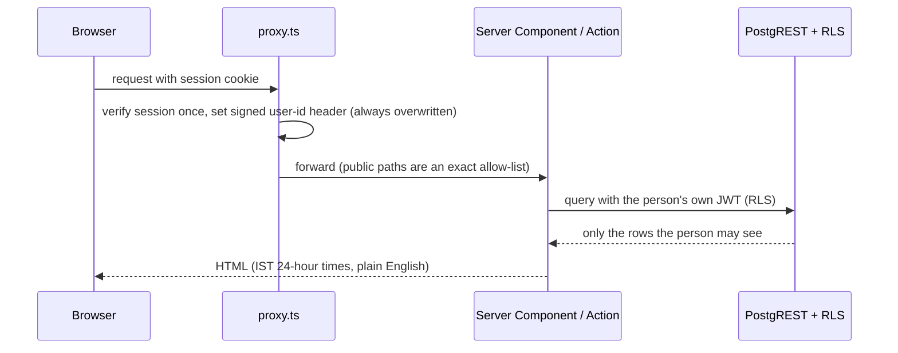

# CityKart Network Monitoring Hub — Architecture, Design and Flow

Document purpose: a self-contained description of the application so that another engineer or AI tool can evaluate the architecture, security model, data model and plans. It contains no secrets and no real network addresses. Written 2026-10-22 against branch `feat/plan-3-live-feeds` (stacked on `feat/plan-2-monitoring`, which is stacked on `feat/plan-1-foundation`). Nothing has been pushed or merged; everything is local.

How to read the status markers:

- **BUILT** = implemented, tested, and reviewed by an independent reviewer (and fixed after review).
- **IN PROGRESS** = being built right now.
- **PLANNED** = written as a task-by-task plan (docs/superpowers/plans/*.md), not built.

---

## 1. What the product is

An internal web application for a retail chain (about 215–300 stores, ~4,600–8,000 CCTV cameras, 1,000+ Windows PCs, all reachable over a company VPN) with four jobs:

1. **Store staff and managers watch CCTV** live and recorded, limited to the stores/cameras they are granted.
2. **IT monitors CCTV cameras and NVRs** (network video recorders) up/down in near real time, with uptime history.
3. **IT monitors every other IP device** (servers, attendance machines, footfall counters, desktops, laptops, printers) by ping/TCP and — for PCs — by a small agent that reports CPU/RAM/disk/errors/inventory proactively.
4. **IT manages Windows PCs remotely from head office**: run approved PowerShell scripts (wallpaper, screensaver, cleanup, configuration), install software, rotate all local administrator passwords, enable the administrator account, queue commands for PCs that are off, diagnose printer/network/mapped-drive problems, open the remote screen (VNC/RDP), and run a guarded Windows repair/reinstall pilot.

It replaces a legacy single-file FastAPI + SQL Server tool (`reference/cctv-hub-legacy/`, read-only) whose NVR logic (Hikvision ISAPI, RTSP checks, playback, backup) is kept and rebuilt on a different stack.

### Environment facts that shape the design

- Windows 10/11 only on desktops/laptops; some PCs are domain-joined, many are in workgroups → **no WMI/WinRM/GPO dependency**; the PC agent is outbound-only PowerShell 5.1.
- All machines are on the VPN: head office can reach them directly. Bandwidth 50–150 Mbps per location.
- TightVNC is installed on most PCs (weak shared password today); RDP where enabled.
- No server management controllers (no iLO/iDRAC), so remote reinstall of servers is out of scope; remote reinstall of PCs is a **guarded pilot only**.
- Cameras are Hikvision (ISAPI over HTTP Digest, RTSP).

---

## 2. Technology stack and conventions

| Layer | Choice |
|---|---|
| Web app | Next.js 16.3 (App Router, Server Actions, `proxy.ts` instead of `middleware.ts`), React 19, TypeScript 5.9, Tailwind 4, shadcn/ui |
| Data | Supabase local stack: PostgreSQL 17, PostgREST, GoTrue (auth), Vault (secrets), row-level security (RLS) |
| Background | Node worker (`tsx`), Node WebSocket gateway, go2rtc media server (Docker) |
| Agent | PowerShell 5.1 script on each PC (PLANNED) |
| Tests | vitest; unit + integration against the local Supabase stack; fake NVR/RTSP/TCP/VNC servers on loopback |
| Validation | zod 4 |
| Reuse | Follows the conventions of an existing in-house app ("Desk"): same stack, two Supabase clients, `Result` type, sanitised errors, IST 24-hour times, plain-English UI text |

Conventions applied everywhere:

- **Server Actions** (`lib/actions/**`) first check the caller (`requireProfile()` / role), then call a **service** in `lib/**` that returns `Result<T>` and never throws to the caller.
- **Two Supabase clients**: `createClient()` (cookie-bound, RLS enforced — used for anything a *person* may read) and `createAdminClient()` (service role, server only — used for writes and secrets, always org-scoped explicitly). Admin writes that reference another row first prove the referenced row is in the caller's organisation.
- **Time**: stored as UTC `timestamptz`, displayed in IST 24-hour through one helper.
- **Errors**: raw database messages never reach the UI (`sanitizeError`), logger redacts secrets.
- **One secret per purpose** (`getSecret(purpose)` with a 16-character minimum): `cron`, `worker`, `stream_token`, `system_log_ingest`. A missing/short secret switches the feature off with a plain message; two purposes must not share a value.
- **Default privileges are closed**: every new table/function/view gets explicit `REVOKE ... FROM PUBLIC, anon, authenticated` then explicit `GRANT`s; a database function `privilege_violations()` is asserted empty in tests.
- **Migrations** are numbered files with a matching rollback script under `supabase/rollback/`.

---

## 3. Runtime architecture

```mermaid
flowchart LR
  subgraph Browser
    UI[Web UI]
    PLAYER[video-stream player / noVNC]
  end
  subgraph Hub["Hub server (head office)"]
    APP["Next.js app :3212\nPages, Server Actions, route handlers"]
    GW["Gateway :3213\nWebSocket proxy, token check"]
    WRK["Worker (Node)\nprobes, state machine, check-now,\n(alerts, backup: planned)"]
    G2R["go2rtc (Docker, loopback only)\nRTSP → browser-playable"]
    subgraph SB["Supabase (Docker)"]
      PG[(PostgreSQL 17\nRLS + SQL functions)]
      VAULT[(Vault secrets)]
      AUTH[GoTrue]
      REST[PostgREST]
    end
  end
  NVR[["Store NVRs / cameras\n(Hikvision)"]]
  DEV[["Devices: servers, attendance,\nfootfall, PCs (TCP/ICMP)"]]
  PC[["Windows PCs + agent\n(planned)"]]

  UI -->|HTTPS, cookie session| APP
  APP -->|RLS client: user's JWT| REST --> PG
  APP -->|service-role client| REST
  APP -->|register stream by name| G2R
  PLAYER -->|WebSocket + signed token| GW --> G2R -->|RTSP| NVR
  WRK -->|service-role| REST
  WRK -->|ISAPI Digest, RTSP DESCRIBE, TCP| NVR
  WRK -->|TCP / ICMP| DEV
  PC -->|outbound check-in over VPN| APP
  GW -.->|VNC login on user's behalf (planned)| PC
```

Processes and ports (local development):

| Process | Port | Role |
|---|---|---|
| Web app (`npm run dev`) | 3212 | pages, Server Actions, route handlers (`/api/health`, `/api/version`; agent API planned) |
| Gateway (`npm run gateway`) | 3213 | only externally reachable video endpoint; verifies a signed token, then proxies a WebSocket to go2rtc |
| go2rtc (`npm run stack:up`) | 1984 (loopback), 8555 (loopback) | media server; its API is unauthenticated and supports `exec:` sources so it must stay on loopback |
| Worker (`npm run worker`) | — | long-running checks, heartbeat to the database |
| Supabase | 55321 API, 55322 DB, 55323 Studio, 55324 mail catcher | local stack in Docker |

The app and the worker talk to the database only over HTTP (supabase-js → PostgREST), never a direct Postgres connection.

---

## 4. Data model (PostgreSQL, `public`)

Every business table has `id uuid`, `org_id` (FK `organizations`), timestamps, and RLS on. The product is single-organisation (CityKart) in practice but keeps the multi-organisation schema. **Same-organisation integrity** is enforced by composite foreign keys `(id, org_id)` on every child link.

### BUILT tables

| Table | Purpose / key columns |
|---|---|
| `organizations` | name, slug, status |
| `profiles` | = `auth.users.id`; role (`user`, `agent`, `manager`, `admin`, `platform_owner`), `is_active`, `must_reset_password`, optional own `store_id` |
| `stores` | code (unique per org, upper-case), name, city, zone, state, `nvr_ip`, `rtsp_port`, `http_port`, `nvr_username`, `nvr_secret_id` (Vault; the password is never in a table), `expected_channels`, `is_active` |
| `cameras` | store_id, channel, name, `camera_ip`, `is_active`; unique (store_id, channel) |
| `devices` | store_id (nullable), type (`nvr, server, attendance, footfall, other`; `desktop, laptop` planned), name, ip, `tcp_port`, `enabled`; unique (org, ip, tcp_port) |
| `user_store_access`, `user_zone_access`, `user_camera_access` | per-user grants (whole stores, zones, individual cameras) |
| `admin_audit_log` | who did what (users, grants, import, groups, discovery, check-now) |
| `check_state` | current status per target (`camera`/`device`/`nvr`; nvr id = store id): `up/down/unknown`, `consecutive_failures`, `first_failure_at`, `last_checked_at`, `last_up_at`, method, plain-English error. **Server-written only** |
| `outages` | target, `started_at`, `ended_at`, `cause` (`nvr_down` or null). One open outage per target (partial unique index). Server-written only |
| `worker_state` | single row: heartbeat, `check_requested_at`, run start/finish, progress, last round times |
| `monitor_gaps` | periods when the worker was not running; excluded from uptime |
| `camera_groups`, `camera_group_items` | named camera sets |

Views/functions: `store_status` (security-invoker view of counts per store), `targets_uptime(...)` (uptime over a window excluding gaps and pre-first-check time), `monitor_apply_results(...)` (the state machine — see §7), `visible_store_ids()/visible_camera_ids()/visible_device_ids()` (access rules), Vault RPCs `nvr_store_credential` / `nvr_read_credential` / `nvr_delete_credential` (service role only), `revoke_user_sessions`, `privilege_violations`.

### PLANNED tables (from the plans)

`notification_channels`, `alert_rules`, `alert_events`, `backup_jobs`, `system_log` (hash-chained), `remote_sessions` + `profiles.remote_access`, `agents`, `agent_enrollment_tokens`, `device_hardware`, `device_software`, `device_metrics` (+ hourly rollups), `device_events`, `device_problems`, `agent_jobs`, `fleet_commands`, `script_library`, `packages`, `device_diagnostics`, `deployment_images`, `deployment_requests`, `deployment_events`, `fleet_schedules`, `snmp_profiles`, `ticket_links`.

---

## 5. Access control (enforced in the database)

Roles: `user` (viewer), `agent` (operator: viewer + check-now + manage camera groups), `manager` (sees everything, read-only), `admin`, `platform_owner`.

Three layers: page guard → Server Action checks → **RLS and table privileges**. The UI never relies on hidden navigation.

Visibility rules live in set-returning, stable, `SECURITY DEFINER` functions, evaluated once per query (`id IN (SELECT visible_...())`):

- **Stores visible** = stores granted directly, stores in granted zones, the person's own store, plus stores that contain an individually granted camera; manager/admin/platform_owner see all.
- **Cameras visible** = individually granted cameras + cameras of granted stores (unless the person has individual grants inside that store, then only those).
- **Devices visible** = devices of granted stores (a camera-only grant does not reveal a store's servers); devices with no store only for manager and above.
- `must_reset_password = true` ⇒ the person has **no organisation and no role** in RLS until they set their own password. No public sign-up. Sessions are revoked on password reset and deactivation.
- Server-only tables (`check_state`, `outages`, `worker_state`, `monitor_gaps`) have read policies for people where appropriate and **no write grants for anyone but the service role**.

Camera groups: a signed-in person sees a group only if they may see at least one camera in it (or created it, or see everything); operators/admins create/change groups and can only add cameras they can see; delete = creator or admin.

---

## 6. Request flows

### 6.1 Sign-in and a page load



### 6.2 Admin write (e.g., import stores, grant access)

Server Action → `requireProfile` → role check (`admin`/`platform_owner`) → zod validation → `assertRefsInOrg` → service-role write → `admin_audit_log` row → `revalidatePath`. NVR passwords go straight to Vault through `nvr_store_credential`; they are never stored in a table or returned.

### 6.3 Live video (BUILT)

```mermaid
sequenceDiagram
  participant B as Browser (LiveTile)
  participant A as Server Action openStreamsAction
  participant DB as RLS client
  participant V as Vault RPC (service role)
  participant G as go2rtc
  participant W as Gateway :3213
  B->>A: camera ids + kind (sub/main)
  A->>A: requireProfile, rate limit (30/min/person), ≤36 ids
  A->>DB: read cameras through RLS (invisible ids silently dropped)
  A->>V: nvr_read_credential(store) once per store
  A->>G: register stream "cam_<id>_sub|main" with the RTSP URL (credentials only server→go2rtc)
  A->>A: sign token {u,c,k,exp=now+600}
  A-->>B: {name, token, camera info} — never a password or rtsp:// URL
  B->>W: WebSocket /g/ws?token=… with Origin header
  W->>W: exact Origin match, verify HMAC token, per-IP limits
  W->>G: ws /api/ws?src=<stream name derived from token ONLY>
  G-->>W: fMP4 (MSE) frames
  W-->>B: frames pass through; session ends at ≤30 min
```

Key properties: the stream name is derived from the signed token only (the browser cannot choose it); token = `base64url(JSON).base64url(HMAC-SHA256('stream.v1.' + payload))`, lifetime 10 minutes enforced in verify, ≥16-char secret required; the gateway refuses (close 1008) before opening any upstream connection; only `mse`/`mp4`/`mjpeg` messages are forwarded from the browser; limits: 240 upgrades/min/IP, 100 concurrent/IP, 300 total, 4 MB client payload, backpressure cut-off; go2rtc error text (which can contain RTSP credentials) is replaced by fixed sentences.

go2rtc behaviour discovered against the real container and designed around: with a read-only config mount, `PUT/DELETE /api/streams` answer HTTP 400 yet apply the change, so the client **confirms via `GET /api/streams?src=<name>`** instead of trusting status codes; registering an already-registered identical source is skipped (no second RTSP producer per camera); idle `cam_*`/`pb_*` streams are pruned with strict name patterns and never while they have consumers. Demo video (no real camera) uses `ffmpeg:virtual?video=testsrc…` only when `DEMO_VIDEO=1`, non-production and loopback store.

### 6.4 Recorded playback (IN PROGRESS: search/calendar BUILT, screen being built)

NVR recording search over ISAPI (`POST /ISAPI/ContentMgmt/search`, daily calendar via `dailyDistribution`) through the same hardened Digest client; paging guards (≤50 pages, ≤5000 segments, repeated-MORE protection) and an explicit `truncated`/`skipped` result; a `PLAYBACK_OFFSET_MIN` setting handles NVR clocks (requested NVR time = shown time − offset; displayed time = NVR time + offset; default 0). A playback token has kind `pb` with start/end claims; the stream is `pb_<camera>_<startEpoch>` registered with an RTSP `tracks/<ch>01?starttime=…&endtime=…` URL. Optional fast playback (2×/4×/8×) via NVR download piped through ffmpeg is PLANNED (ffmpeg is not installed on the dev host; must degrade gracefully).

---

## 7. Monitoring (BUILT)

### 7.1 What is checked and how often

| Target | Method | Interval |
|---|---|---|
| Servers, attendance, footfall, other devices | TCP connect to `tcp_port`, or ICMP ping when no port | 60 s |
| NVR reachability | TCP connect to the RTSP port | 60 s |
| Cameras of a store | ISAPI `InputProxy/channels/status` from the NVR (HTTP Digest, never Basic); cameras the NVR does not report online are re-checked with an RTSP DESCRIBE on the sub-stream | 300 s |

ICMP success requires a real echo reply (`TTL=` in the output **and** exit code 0), because Windows `ping` can print "Destination host unreachable" with exit 0. RTSP uses the actual status code (200 live; 401 = reachable but refused login).

### 7.2 State machine (one SQL function, atomic)

`monitor_apply_results(...)` receives batches of `{type, id, ok, at}`:

- A target goes **down after 2 consecutive failures** and **up on the first success**.
- The **outage starts at the time of the first failure** of the run.
- If the NVR is down, its cameras are marked down at once (threshold 1) with `cause = 'nvr_down'`; the dashboard shows the NVR outage, not each camera.
- A failure left over from before a worker stop is discarded if a recorded gap overlaps the silent period (so outages are not dated before a stop).
- Results for switched-off stores/devices/cameras are ignored; switching a target off closes its open outages and clears its state.
- Only the service role can call it; inputs from the caller are validated (uuid shape, known types).

### 7.3 Worker design

- Per-target serialisation (a promise chain per lane) so a late result never overwrites a newer one; a pool limits store concurrency (default 10, env `STORE_CONCURRENCY`).
- Heartbeat every 5 s on its own timer so a long round never stalls it; "silent" periods without a restart are recorded as gaps too.
- Check-now: `worker_state.check_requested_at` stamped with the **database clock**; the worker polls every 5 s, waits for an in-flight scheduled cycle then runs a fresh one, retries once if database failures made the first run incomplete, never reports a run finished without checking. Global cooldown 30 s; allowed roles: operator (`agent`), `admin`, `platform_owner`.
- NVR login problems: if ISAPI fails with auth/forbidden or no password is saved, **no results are sent for that store's cameras** (no false outages) and requests to that NVR back off for 15 minutes (account lock-out protection), ending early if the stored credentials change.
- A single-worker start-up guard (heartbeat based; documented race windows; a lease column is the planned hardening) and graceful shutdown.
- Status presentation: `Live`, `Offline`, `Not checked yet` (never checked) and `Not checked lately` (last good result older than 20 minutes — excluded from Live counts). Uptime 24h/7d/30d excludes monitoring gaps; a stopped monitor shows "Monitoring is not running" and "No data", not downtime.

### 7.4 Camera discovery

Admin action "Find cameras" reads the NVR channel list (ISAPI, fallback endpoint) and upserts cameras on `(store_id, channel)` so ids stay stable; keeps stored IPs/names when the NVR returns placeholders; NVR-reported camera IPs are stored only if valid and are **never probed**.

---

## 8. Security model (cross-cutting)

- **Secrets**: NVR/remote passwords only in Vault, read only through service-role RPCs at use time, never cached in tables/logs/responses; per-purpose app secrets with minimum length; demo passwords generated randomly and printed once to the terminal only.
- **No Basic authentication anywhere**; HTTP Digest only. A device that offers only Basic is reported as unsupported.
- **Tokens**: HMAC-SHA256, domain-separated, short-lived, one person/one camera/one kind; strict claim validation; verification never throws; the MAC is computed over the exact received payload segment.
- **Gateway**: exact path + Origin allow-list + token before any upstream connection; no go2rtc detail in responses; message-type allow-list; per-IP limits; slow-request timeouts; security headers; CORS only for allowed origins on the two player scripts.
- **Egress guard in tests**: a preloaded guard refuses any non-loopback TCP connection and any `ping`/`tracert` to non-loopback addresses through every `child_process` entry point, so a test can never probe a real store. Integration tests run only against the local stack (`assertLocalStack`).
- **SQL hygiene**: `SECURITY DEFINER` functions pin `search_path`; closed default privileges; explicit grants audited by `privilege_violations()`.
- **Rate limits** on logins, admin actions, import, stream opening (in-process; documented limit that multiple app copies each allow the full rate).
- **CSV exports** neutralise leading `= + - @`. Content-Security-Policy and further hardening: PLANNED (Plan 4).

---

## 9. Testing and quality process

- Unit tests (≈730) and integration tests (≈240) pass at the end of each task; typecheck, lint and production build are gates.
- Integration tests use disposable organisations on the local stack and fake NVR (HTTP Digest ISAPI), RTSP, TCP and (planned) VNC servers on loopback.
- **Development process**: each task is implemented by a fresh AI sub-agent working test-first, then reviewed by an independent reviewer (spec compliance + quality; opus for security-critical code), with up to several fix rounds; a final whole-branch review per plan. Plan 2's final review found 6 important cross-task issues that per-task reviews missed (stale outage starts after a worker stop, silent gaps without restart, switched-off targets, stale states shown as Live, Home "last checked", NVR/camera grouping), all fixed with tests.
- Real hardware, real store networks and real video over the VPN are **not** covered by automated tests; those need a pilot at a real store.

---

## 10. Build status and branch map

| Plan | Scope | Status |
|---|---|---|
| 1 Foundation | project, auth, roles, grants, users admin, stores/cameras/devices, CSV import, RLS tests | BUILT, reviewed (branch `feat/plan-1-foundation`) |
| 2 Monitoring | NVR/RTSP/TCP/ICMP checks, state machine, uptime, worker, discovery, check-now, status UI, demo tools | BUILT, reviewed incl. final whole-branch review (branch `feat/plan-2-monitoring`) |
| 3 Live feeds | camera groups (BUILT), stream tokens + go2rtc client (BUILT), gateway + Docker go2rtc (BUILT), live wall (BUILT), NVR recording search (BUILT), playback screen (IN PROGRESS), fast playback/clips (PLANNED, optional), wire-up/demo (PLANNED) | in progress (branch `feat/plan-3-live-feeds`) |
| 4 Alerts, reports, backup, hardening | rules/events/engine with e-mail, Teams, webhook; fixed reports with Excel export; NVR backup jobs; hash-chained `system_log`; CSP, column grants, rate limits, deployment material | PLANNED |
| 5 Remote screen | VNC through the gateway (hub performs the VNC login with the vault password; view-only filter; noVNC), RDP file download, per-user remote access, session log | PLANNED |
| 6 Agent + fleet | PowerShell agent, health ingest and rules, enrolment, signed command queue (offline PCs run commands when they return), script library, packages, local admin password rotation, diagnostics (printers/network/mapped drives), fleet dashboard | PLANNED |
| 7 Windows deployment | Windows 11 readiness, image hosting, two-person-approved scheduled in-place repair/reinstall pilot (destructive step off by default twice), clean-reinstall runbook only | PLANNED |
| 8 Extras | Wake-on-LAN relay, recurring commands, security posture, SNMP (read-only) for printers/switches, regional outage correlation, ticket hand-off | PLANNED |

Rulings made during the build (selected): no Basic auth (R6); no camera outages on NVR login problems (R8) and back-off (R9); stale = 20 minutes (R10); deactivation closes outages (R11); playback offset direction (R13); go2rtc loopback-only and confirm-by-list (R14, R16); stream request limits (R15, R17).

---

## 11. Design of the planned parts (for review)

### 11.1 PC agent and command queue (Plan 6)

- **Agent**: PowerShell 5.1 service/scheduled task, outbound only. One check-in per minute sends metrics (CPU, RAM, disks, uptime, pending reboot/updates, AV status), a daily inventory (serial numbers, Windows version/build, installed software) and receives due commands.
- **Enrolment**: administrator creates a limited-use enrolment token (stored hashed, expiry + use limit); the agent exchanges it for its own random 32-byte device token (shown once; only a SHA-256 hash is stored). Agent routes are exact public paths that authenticate themselves; check-in limited to once per 20 s per device.
- **Commands** (allow-list in the DB): `collect_info`, `run_script`, `install_package`, `reboot`, `set_admin_password`, `enable_admin_account`, `windows_update_scan`, `windows_update_install`, `run_diagnostic` (read-only). Scripts come only from a versioned, administrator-managed script library; there is no free-text "run on 1,000 PCs" box.
- **Signing**: each command is signed at hand-out with HMAC-SHA256 over `jobId|kind|canonical params|expires` using the device's own token; the agent verifies the signature, expiry and that the kind is enabled in its local config.
- **Queue state machine**: `awaiting_approval → queued → sent → running → succeeded|failed`, plus `expired`, `cancelled`, `rejected`; a `sent` job without a result for 15 minutes returns to `queued` (3 attempts); per PC one job at a time ordered by priority then creation; every job has `not_before` and an expiry (default 30 days) — **an offline PC runs everything queued, in order, when it comes online**.
- **Approval**: a fleet command that changes anything for more than one PC, or any high-risk command, needs a second administrator (never the requester); read-only commands need none.
- **Local administrator passwords** are generated on the PC (20 random characters), returned once, moved to the vault by the hub and removed from the stored result; revealing one asks for a reason and writes a security log entry.
- **Packages**: winget IDs or hub-hosted files with a SHA-256 the agent verifies; silent arguments fixed per package.
- **Health rules** run in the database as data arrives and open/close `device_problems`, each with a suggested fix script. Retention: raw metrics 30 days, hourly 400 days, events 90 days.
- **Safety stance**: no test or demo ever changes a real machine; the agent is exercised only in dry-run/self-test modes and against a fake executor.

### 11.2 Remote screen (Plan 5)

The browser runs noVNC and connects to the same gateway. The gateway checks a signed remote token (different claim shape and domain, lifetime 2 minutes), loads the PC address and its VNC password from the vault, **performs the VNC authentication itself** (pure-TypeScript DES because Node/OpenSSL 3 disables DES) and presents a password-less session to the browser; in view-only mode it drops every keyboard/mouse/clipboard message. One control session per machine, ≤3 view-only, 60-minute / 10-minute-idle limits, every session logged. Passwords never reach a browser; the machines can later be locked to accept VNC only from the gateway address. RDP is offered as a downloadable `.rdp` file.

### 11.3 Windows deployment pilot (Plan 7)

State machine `requested → approved (two distinct non-requester admins) → preflight → staging (resumable download, SHA-256) → awaiting window → applying → completed|failed`, only inside a scheduled window with a fresh passed preflight; the apply step requires a hub switch **and** an agent local setting; servers are refused; a clean reinstall is a lab-validated runbook plus a stub, not an automatic feature.

### 11.4 Alerts, reports, backup, hardening (Plan 4)

Rule engine over open/closed outages with a default 5-minute delay, one alert per rule+outage, recovery messages, no alert for cameras down because of `nvr_down`; channels e-mail (SMTP env vars), Teams and generic webhook (URLs in vault); reports through RLS capped at 20,000 rows with audited, CSV-injection-safe Excel export; backup jobs (one download per NVR at a time, ≤4 NVRs, 5 GB free-space floor); hash-chained system log; CSP (script-src/connect-src must include the gateway origin because the player script is a module from that origin); column grants and further hardening items each with a failing-before/passing-after test; Docker/Windows deployment material.

---

## 12. Known limitations and risks (honest list)

1. **Not validated on real hardware/networks**: ISAPI variants across Hikvision firmware (e.g., times without `Z`, search paging quirks), recordings crossing midnight, MSE playback on older iOS (< 17.1 shows "Video is not available").
2. **Single worker assumption**: start-up guard is heartbeat based with race windows; check-now is global (one worker row); a lease column is the planned fix.
3. **Gateway sessions** last up to 30 minutes after the token's 10-minute connect window; deactivating a user takes effect at their next connection, not on a running stream.
4. **go2rtc API** is unauthenticated and supports `exec:` sources; safety relies on loopback binding, a read-only config mount, and the gateway never forwarding arbitrary sources.
5. **In-process rate limits** are per process (multiple app instances multiply them).
6. **Scale**: designed for ~300 stores / 8,000 cameras / thousands of devices; a cameras round must finish within the 20-minute "stale" threshold at fleet scale; to be load-tested in Plan 4.
7. **Remote reinstall** is unproven and deliberately guarded; the agent protocol and queue are designed but not built.
8. **Weak existing VNC password** on most PCs is an environment risk the hub mitigates (hub-side login, vault) but does not remove until PCs are re-keyed.
9. **tsx is a dev dependency** used to run the worker/gateway; production packaging (compile or move to dependencies) is a Plan 4 deployment item.
10. Windows 10 reached end of support on 14 Oct 2025; the fleet dashboard will flag those PCs.

---

## 13. Questions for the reviewer

Please evaluate and challenge:

1. **Security architecture**: Is the split of RLS client vs service-role client, plus the SECURITY DEFINER visibility functions, sound? Any privilege-escalation or cross-tenant paths? Is the closed-default-privileges pattern enough?
2. **Video path**: token design, gateway checks, go2rtc exposure, session length vs revocation. What would you change before exposing the gateway beyond the VPN?
3. **State machine and uptime**: correctness of the 2-failure rule, outage start time, `nvr_down` grouping, gap handling, stale handling. Any scenario that makes the UI show a wrong status or uptime?
4. **Agent/queue design (planned)**: command signing with the per-device token, approval rules, offline queue semantics, local admin password handling, package install trust. What attack paths exist if the hub or one PC token is compromised? Is a PowerShell outbound agent the right choice vs alternatives for a mixed domain/workgroup fleet?
5. **Remote screen (planned)**: hub-side VNC login with vault passwords and view-only filtering — risks of a central credential store and a protocol proxy.
6. **Scalability**: PostgREST-only access, per-store RPC batching, paging; the worker as a single process; 1,000+ agents checking in each minute against Next.js route handlers.
7. **Operational readiness**: deployment on Windows hosts vs Docker, backups of Supabase/Vault, secret rotation, observability, disaster recovery.
8. **Process/testing**: gaps in the testing strategy given that real NVRs and PCs are not exercised; the egress guard and fakes approach.
9. **Scope/sequence**: is the plan order right? What should be cut or deferred (e.g., the Windows reinstall pilot, SNMP, ticketing)?
10. Anything over-engineered or missing for a 1,000-PC / 300-store estate run by a small IT team.

---

## 14. Repository map (BUILT parts)

```
app/(auth)/…            login, forgot/reset password, change password
app/(app)/…             home, stores, stores/[id], devices, groups, live, playback (in progress),
                        admin/(users, users/[id]/access, stores, devices, import, monitoring)
app/api/                health, version
components/             layout (shell, nav, icons), admin, groups, live (wall, tile, player hook), monitor (status badge, check-now, find-cameras)
lib/actions/            Server Actions (admin/*, groups, monitor, streams, …)
lib/admin|auth|groups|inventory|import|queries/   services, role helpers, CSV import, status queries
lib/monitor/            checks, runner, config, health, guard, uptime, discovery, Supabase data layer
lib/nvr/                digest (HTTP Digest only), isapi parsers, client, playback (recording search)
lib/rtsp/ lib/probes.ts RTSP DESCRIBE, TCP/ICMP probes
lib/streams/            token, go2rtc client, source builders, gateway, openStreams
services/worker, services/gateway   process entry points
supabase/migrations|rollback/       numbered SQL + rollback
deploy/                 go2rtc compose + config (normal and demo)
scripts/                dev-admin creation, fake NVR, demo seed
tests/unit|integration|helpers|setup/   incl. egress guard and fake servers
docs/superpowers/specs|plans/           design spec and plans 1–8
```
