# CityKart Drishti (CKDRISHTI) — architecture and design

The single source of truth for how Drishti is built, what is built today and what is planned. It replaces `docs/ARCHITECTURE-AND-DESIGN-FOR-REVIEW.md` (pre-directive design, Plans 1-3, kept for history). Written so that another engineer or AI can evaluate the application without reading the code first; every claim names the file that proves it.

- **Written:** 2026-10-22, branch `feat/drishti-p2-access-location`, HEAD `0a33411` (last schema migration `20261021000016`). Nothing has been pushed or merged; everything is local.
- **Method:** the requirement and decision documents were read; every component status below was checked against the code and migrations named next to it. No server, database command, test suite or container was run for this document (builders were active in the tree), so test counts are taken from the latest recorded evidence (section 10).
- **No secrets, no real addresses.** Ports are local development ports.

Status markers used throughout:

| Marker | Meaning |
|---|---|
| **BUILT** | Code is committed on the current branch and covered by passing tests in the recorded evidence. "BUILT" never means "validated on real hardware" — see section 12. |
| **BUILT (fakes only)** | Committed and tested, but only against local fakes (fake NVR, fake ffmpeg, fake adapter, synthetic data). |
| **IN PROGRESS** | A work package is being built or reviewed now. |
| **PLANNED** | Accepted design (decision or brief) with no code yet. |
| **NOT PLANNED YET** | A requirement with no design work package. |

Companion documents (not duplicated here): requirements `docs/drishti/REQUIREMENTS-DIRECTIVE.md` and `REQUIREMENTS-SUPPLEMENT-WIFI.md`; decisions `docs/drishti/DECISIONS.md` (full decision text in `docs/audit/REWORK-PLAN-PROPOSAL.md` §9.3); requirement-by-requirement status and evidence `docs/drishti/DELIVERY-STATUS.md` (the tracker); access model `docs/drishti/access-model.md`; job engine `docs/drishti/job-engine.md`; endpoint telemetry `docs/drishti/agent-telemetry.md`; Wi-Fi research `docs/drishti/wifi-capability-research.md`; legacy parity `docs/drishti/LEGACY-HANDOFF-GAP-ANALYSIS.md`; design tokens `docs/design/drishti-tokens.md`.

---

## 1. Purpose, scope and environment

### 1.1 What the product is for

One internal web application for CityKart with four jobs (directive, "Product and environment"):

1. **Authorised CCTV**: live viewing, recorded playback and video exports across CityKart locations, each right granted separately.
2. **Central monitoring** of CCTV cameras, NVRs, servers, desktops, laptops, attendance machines, footfall machines, Wi-Fi access points and other network assets.
3. **Controlled IT remote support and endpoint administration** (read-only inventory first; signed, approved, staged changes later).
4. **Proactive detection and investigation** of operational IT problems, with honest states (failed versus unreachable versus unknown versus stale).

Module 9 (Wi-Fi supplement): central monitoring and configuration management of NETGEAR APs — change a configuration once, roll it out to an explicitly selected set of compatible APs with verification; drift is detected, never mirrored.

Drishti continues the Plans 1-3 application (it was not restarted) and replaces a legacy FastAPI + SQL Server "CCTV Hub" (`reference/cctv-hub-legacy/`, handoff copy `docs/reference/cctv-hub-handoff-2026-10-21.md`).

### 1.2 Environment facts that shape the design

| Fact | Consequence in the design |
|---|---|
| About 200+ retail stores plus head office, DCs and other locations; the legacy hub had imported about 4,603 cameras; earlier sizing used up to ~300 locations / ~8,000 cameras / 1,000+ Windows PCs | Effective-access functions are measured at 8,100 cameras × 200 people (`tests/integration/access-performance.test.ts`); location is a first-class concept (ruling T-1) |
| Locations connect through **SD-WAN**; head office reaches location assets over the company network/VPN; 50-150 Mbps per location (earlier spec) | Probes and video run from head office; "unreachable from head office" must not be reported as "failed" (D-5, D-7); the SD-WAN addressing plan is unknown, so IP is not an identity (D-4 `address_spaces`) |
| Recorders are **Hikvision NVRs** (ISAPI over HTTP Digest, RTSP); some main streams are H.265; NVRs are configured in IST (UTC+05:30) | Digest only, never Basic (ruling R6); sub-streams for grids; codec matrix and transcode option planned (WP-4.4, P4-L5); per-recorder clock offset planned (D-17) |
| A location can have **several NVRs** | Today's schema still holds one NVR on the store row — the largest data-model gap (P2-5) |
| Windows 10/11 desktops and laptops, **mixed domain-joined and workgroup** | No dependency on GPO/WinRM for the fleet; an outbound PowerShell 5.1 agent is the primary endpoint mechanism (D-9: ECDSA P-256 because .NET Framework has no Ed25519); Windows LAPS only for eligible joined devices, a separate workgroup design |
| **TightVNC** on many endpoints (shared, weak password today), **RDP** on some | Remote view and control are separate capabilities enforced in the protocol path (WP-7.4); VNC credentials rotated through a controlled migration; a downloaded `.rdp` file is labelled "no Drishti-enforced controls" |
| **NETGEAR APs**: about 10 at head office, 4-5 per store, several models (WAX615 named), each store with its own IP pool | Documentation research found no documented programmatic configuration interface for standalone mode, SNMPv3 read-only as the first real adapter, Insight API partner-only (`docs/drishti/wifi-capability-research.md` §6-7). Every operation stays `unverified` until a hardware pilot |
| No server management controllers (iLO/iDRAC) | Remote server reinstall is out of scope; Windows PC deployment is a guarded lab-validated phase (Phase 8) |
| Legacy hub facts (handoff): go2rtc API leaked NVR credentials unless bound to loopback; health = ISAPI "online" OR RTSP DESCRIBE; NVR downloads may be MPEG-PS wrapped (Windows players cannot open them); users and groups lived in SQL Server; UI was Hindi | Drishti keeps go2rtc on loopback behind a gateway, keeps the two-source camera check, plans an ffmpeg remux for exports (P4-L4), needs the owner's data export to import the real estate (D-L4 open), and is English only (D-L3) |

### 1.3 Development rules that are part of the architecture

Local only: no push, no merge into `main`, no production change; fakes and synthetic data by default; no probing or changing real stores, NVRs, PCs or APs without explicit owner authorisation (directive "Development and validation"; `.superpowers/sdd/drishti/constraints.md`). Tests are physically prevented from reaching the network (section 8.7). The owner's dev server on port 3212 is never restarted by a builder.

---

## 2. Technology and conventions

| Layer | Choice (verified in `package.json`, `supabase/config.toml`) |
|---|---|
| Web app | Next.js 16.3.8 (App Router, Server Components, Server Actions, `proxy.ts` instead of `middleware.ts`), React 19.2, TypeScript 5.9, Tailwind CSS 4, shadcn/ui on `@base-ui/react`, `sonner`, `lucide-react` |
| Data | Supabase local stack: PostgreSQL 17, PostgREST (max 1000 rows per answer), GoTrue (password auth, no public sign-up), Vault (secrets), row-level security. Realtime, edge runtime, logflare, vector, imgproxy and supavisor are excluded (`npm run db:start`) |
| Background | Node processes run with `tsx`: monitoring worker, WebSocket video gateway (`ws`); go2rtc 1.9.9 in Docker, pinned by digest |
| Endpoint | PowerShell 5.1 read-only collector (`agent/windows/collector/Collect-DrishtiInventory.ps1`); no agent service yet |
| Validation | zod 4 |
| Tests | vitest 3; unit and integration (integration against the local Supabase stack, one file at a time); fake NVR / RTSP / TCP / ffmpeg servers on loopback |

Conventions applied everywhere (checked in the code named):

- **Server Actions** (`lib/actions/**`) check the caller first — session, active, password chosen, capability and scope, then administrative role where relevant — then call a service in `lib/**` that returns a `Result` and never throws to the client.
- **Two Supabase clients**: the person's own cookie-bound client (`lib/supabase/server.ts`, RLS applies) for everything a person reads and for every authorisation question; the service-role client (`lib/supabase/admin.ts`) only after an allowed answer, always scoped to the person's organisation (`lib/security/org-scope.ts` `assertRefsInOrg`).
- **Authorisation is asked of the database** as the person, through `lib/auth/resource.ts` (section 5.6). A refused camera looks exactly like a missing one.
- **Time**: `timestamptz` in UTC, shown in IST 24-hour through `lib/time.ts`. Exception: playback uses an internal "shown time" (a fake-UTC instant carrying the IST wall clock, `lib/streams/timeline.ts`), to be replaced by true UTC in D-17.
- **Errors**: raw database or device messages never reach the UI (`lib/observability/sanitize-error.ts`); the logger redacts by key name and by pattern (`lib/observability/logger.ts`, `mask.ts`).
- **Secrets per purpose** (`lib/secrets.ts` `getSecret`, minimum 16 characters, a missing secret turns the feature off). Caveat: the proxy's verified-user header is signed with `SUPABASE_SERVICE_ROLE_KEY` (`lib/auth/verified-user.ts`), so that key serves two purposes.
- **Database**: numbered forward migrations, each with a rollback in `supabase/rollback/`; closed default privileges and explicit `REVOKE`/`GRANT` on every object; every SECURITY DEFINER function from migration 0009 on uses `SET search_path = ''` with qualified names. Functions from migrations 0001-0006 that were not redefined later still pin `search_path = public` (for example `monitor_apply_results`, `nvr_read_credential`) — fixed in P2-6.
- **Wording**: plain English, IST times, no jargon; "Location" in user-visible text (ruling T-1; the rename pass has not run yet, so the UI and routes still say "store" — section 11).

---

## 3. Runtime architecture

### 3.1 Today (local development)

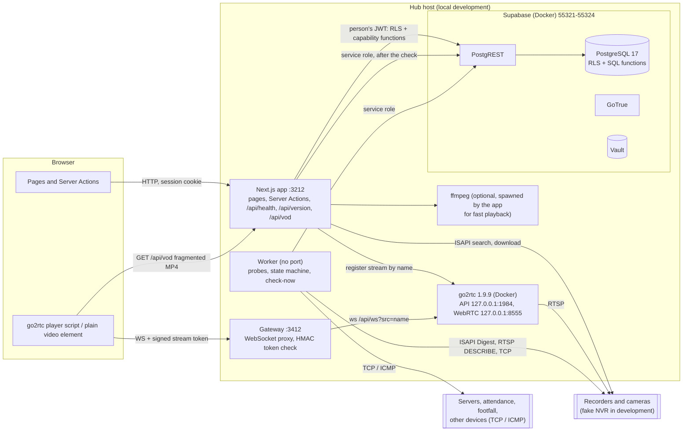

All database access is over HTTP through supabase-js and PostgREST; there is no direct Postgres connection and no `LISTEN/NOTIFY` (no `pg` dependency). This is why session revocation is designed as polling (D-3).

### 3.2 Processes and ports

| Process | Start | Port / bind | Status | Notes |
|---|---|---|---|---|
| Web app | `npm run dev` / `npm run start` | **3212**, all interfaces, plain HTTP | BUILT | No `--hostname` in `package.json`, so it listens on all interfaces (risk R10); `output: 'standalone'` |
| Video gateway | `npm run gateway` (`services/gateway/index.ts`) | **3412**, `0.0.0.0`, plain HTTP/WS | BUILT | The only video endpoint a browser reaches; serves `/g/ws`, `/g/video-stream.js`, `/g/video-rtc.js`, `/g/health`; no database connection today |
| go2rtc | `npm run stack:up` (`deploy/docker-compose.dev.yml`, `deploy/go2rtc.yaml`) | **1984** API and **8555** WebRTC tcp/udp, both published on `127.0.0.1` only | BUILT | `cap_drop: ALL`, `no-new-privileges`, config mounted read-only, RTSP server off. API has no credentials; WebRTC listener is unused but still enabled (D-13 removes it) |
| go2rtc demo override | `npm run stack:up:demo` (+ `deploy/docker-compose.demo.yml`, `go2rtc.demo.yaml`) | adds RTSP **8554** on the container's own `127.0.0.1` (not published) | BUILT (dev only) | Needed only for the generated test picture (`DEMO_VIDEO=1`, non-production, loopback NVR address) |
| Worker | `npm run worker` (`services/worker/index.ts`) | none | BUILT | Service-role key; heartbeat-based single-worker guard (`lib/monitor/guard.ts`) — to be replaced by a lease (P2-7) |
| Supabase | `npm run db:start` | 55321 API, 55322 DB, 55323 Studio, 55324 mail catcher (55320 shadow DB for diffs) | BUILT | `supabase/config.toml` |
| Fake NVR and devices | `npm run fake:nvr` (`scripts/fake-nvr.ts`) | `127.0.0.1`: ISAPI 8081 (default), RTSP 8554, TCP 9101-9103 | BUILT (dev only) | Demo data: `npm run demo:seed` (DEMO organisation, generated passwords printed once) |
| ffmpeg | spawned per fast-playback request by the web process (`lib/streams/vod.ts`) | none (pipe only) | BUILT (fakes only) | Not installed on the development host; never run end to end |

### 3.3 Target service separation (D-14, D-14a; P2-6 PLANNED)

Today every server process uses the one `service_role` key. The accepted target is per-service database roles through PostgREST role-switching JWTs (after a spike; fallback: one key plus a credential broker process):

| Role | May do |
|---|---|
| `app_web` | no Vault access; writes through narrow RPCs |
| `monitor_worker` | read recorder credentials for monitoring; write observations; lease RPCs |
| `media_service` | read recorder credentials for video; manage `media_sessions` and `export_jobs`; owns go2rtc registration and ffmpeg (moved out of the web process, WP-4.3) |
| `video_gateway` | EXECUTE only on `media_session_open` / `media_sessions_still_valid` / `media_session_close` |
| `fleet_service` | Phase 7: job store and agent API; separate from media processing |
| signer (separate Windows service) | holds the command-signing key in CNG, signs only after its own database checks (D-9) |

Every Vault read will be logged (`vault_reads`, no values). Production packaging (Windows services with auto-start, `tsx` out of production, one-command update, visible version) is WP-5.4.

---

## 4. Data model

### 4.1 As it exists now (migrations `20261021000001` … `20261021000016`)

Every business table has `id uuid`, `org_id`, timestamps and RLS on. The product is single-organisation in practice but keeps the multi-organisation schema; same-organisation integrity uses composite foreign keys `(id, org_id)` (exception: `check_state` and `outages` target ids are polymorphic, not foreign keys).

| Table | Key columns and rules | Source |
|---|---|---|
| `organizations` | name, slug, `is_owner`, status | 0001 |
| `profiles` | `id` = `auth.users.id`; `role user_role` ∈ {`user`, `operator`, `manager`, `admin`, `platform_owner`} (`agent` renamed in 0008); `is_active`, `must_reset_password` (until chosen, the person has no organisation or role in RLS), `store_id` (home location: information only, grants nothing), `access_version` (bumped by every grant change) | 0001, 0008, 0009 |
| `stores` (= locations until P2-5) | code (unique per org, upper case), name, city, zone, state, address, `is_active`, **`nvr_ip`, `rtsp_port`, `http_port`, `nvr_username` (NOT NULL), `nvr_secret_id`** (Vault), `expected_channels`. Signed-in people may select only the non-NVR columns (column grants, 0011) | 0002, 0011 |
| `cameras` | `store_id`, `channel`, name, `camera_ip` (not selectable by signed-in people), `is_active`; **`UNIQUE (store_id, channel)`** — camera identity is tied to the store's single NVR channel | 0002, 0011 |
| `devices` (= assets until P2-5) | `store_id` (nullable), `type device_type` ∈ {`nvr`, `server`, `attendance`, `footfall`, `other`}, name, `ip`, `tcp_port`, notes, `enabled`; **`UNIQUE NULLS NOT DISTINCT (org_id, ip, tcp_port)`** (global IP uniqueness, blocked on the SD-WAN answer, AL-6) | 0002, 0004 |
| `capabilities` | read-only catalogue of **28** capabilities: key, area (`cctv`/`it`/`wifi`/`admin`), risk, `requires_mfa` (constraint: `= risk 'high' OR key 'cctv.export'`), allowed `scope_kinds` | 0009 |
| `access_grants` | one capability at one scope (`organization`/`location`/`camera`/`asset`) for one person: `scope_id` plus typed `location_id`/`camera_id`/`asset_id` (composite FKs), `valid_from`, `valid_until`, `granted_by/at`, `reason`, `revoked_at/by`, `revoke_reason`, `source` (`manual`, `migrated:store|zone|home|manager|camera|admin`), `needs_review`. Append-only (triggers); one live row per person, capability and scope (partial unique index) | 0009, 0012 |
| `access_migration_report` | one row per person from the one-time migration: old model, new grants, note | 0009, 0010 |
| `access_grant_reviews` | append-only "kept" confirmations of migrated / flagged grants (one per grant) | 0015 |
| `user_store_access`, `user_zone_access`, `user_camera_access` | **retired**: no policy, no access, read by no access rule; kept one release for the migration report test | 0002, 0011 |
| `admin_audit_log` | actor, action, entity, `detail jsonb`; best-effort inserts; readable with `admin.audit.read`; mutable by the service role | 0002, 0011 |
| `check_state` | per target (`camera`/`device`/`nvr`, where an NVR id is the store id): `status` ∈ {`up`,`down`,`unknown`}, `consecutive_failures`, `first_failure_at`, `down_since`, `last_checked_at`, `last_up_at`, `method`, `error`. `error`/`method` not selectable by signed-in people (0014); server-written only | 0005, 0014 |
| `outages` | target, `started_at`, `ended_at`, `cause` (null or `nvr_down`); one open outage per target (partial unique index) | 0005 |
| `worker_state` | single global row (`id = 1`): heartbeat, `check_requested_at`, run start/finish, progress, last device/camera round times; service role only | 0005, 0006 |
| `monitor_gaps` | periods without a running worker, excluded from uptime; service role only | 0005 |
| `camera_groups`, `camera_group_items` | named cross-location camera sets; group name **unique per organisation** (leaks that a hidden group has a name, AC-11) | 0007 |

Views: `store_status` (security invoker, per-store counts); `store_nvr_endpoints` and `camera_endpoints` (owner-rights, `security_barrier`, filtered to the caller's organisation and IT view — the only way a signed-in person reads NVR or camera addresses; the Vault id is never exposed).

Functions (grouped; exact privileges are asserted by `tests/integration/access-model.test.ts` VA-19 and `hardening.test.ts`):

| Group | Functions |
|---|---|
| Identity | `current_org_id()`, `current_user_role()`, `revoke_user_sessions(user)` (service role), `set_updated_at` |
| Effective access (as the caller) | `has_capability`, `has_capability_for(cap, kind, id)`, `capability_camera_ids/store_ids/device_ids`, `any_cctv_camera_ids`, `cameras_with_capability(cap, ids[])`, `any_grant_store_ids`, `it_view_store_ids`, `it_view_device_ids`, `cctv_visible_group_ids`, `my_access_summary()` (0013), `status_reasons(type, ids)` (0014), `mfa_enforced()` (returns false until P3) |
| Grant writes and preview (service role, actor checked) | `grant_access`, `revoke_grant`, `replace_user_grants` (tooling/tests), `preview_access_change(org, user, changes, at, sample)`, `apply_access_change(org, user, changes, actor, expected_version)` (0015), `access_review_keep`, `access_grant_summary(org)`, `access_expiring(org, within)`, `grant_platform_owner_all(org, user)` (0016); internal `access_check_manager`, `access_check_grantor`, `access_put_grant`, `access_merge_window` |
| Triggers | append-only grant triggers; `capabilities_grant_platform_owners` (new catalogue entry → granted to every active super administrator); `profiles_platform_owner_full_rights` (promotion or reactivation → full set) |
| Reporting / diagnostics only (never authorisation) | `report_effective_camera_ids/device_ids`, `access_session_capabilities`, `access_legacy_*`, `access_migrate_legacy(_test)`, `function_privileges()` |
| Inventory secrets (service role) | `nvr_store_credential(store, secret)`, `nvr_read_credential(store)`, `nvr_delete_credential(store)` (Vault name keyed by store) |
| Monitoring (service role) | `monitor_apply_results(org, results, threshold)`, `monitor_request_check()`, `monitor_stop_targets`, `monitor_stale_after_minutes()` (20), `targets_uptime(...)`; triggers `monitor_forget_target` (delete erases a target's state), `monitor_stop_*` (switching off closes outages) |
| Hygiene | `privilege_violations()` (relations only; function EXECUTE, sequences and the global default ACL are not covered — P2-6) |

RLS summary (0011, 0014): cameras visible with any CCTV capability covering them; devices only with `it.inventory.view` or `it.monitoring.view` (a CCTV grant never reveals IT, AC-4); locations with any grant inside them; `check_state`/`outages` per target type (camera like cameras, device like devices, NVR with the IT view of the location); groups only with a visible member (an empty group: creator and `admin.inventory`); items per visible camera; profiles: own row, the organisation's with `admin.users` (no role literal since 0014); grants: own, the organisation's with `admin.access`; audit log with `admin.audit.read`. No table is writable by signed-in people; `anon` reads nothing (`tests/integration/hardening.test.ts`).

### 4.2 Planned model (clearly separate from the above)

| Planned object | Design | Package | Status |
|---|---|---|---|
| `locations` (rename of `stores`, ids kept) | `kind` ∈ {store, head_office, dc, warehouse, other}, `parent_location_id`, `uplink_asset_id`; NVR columns move out and are dropped | P2-5a (D-4) | PLANNED |
| `assets` (rename of `devices`, ids kept) | serial, MAC, vendor, model, firmware, role, owner, criticality, lifecycle state, warranty, `last_inventory_at`, management mode, `capability_discovered_at`, `credential_ref` (Vault name), config owner, assigned profile, `archived_at`; type enum extended (sdwan_edge, switch, access_point, router, ups, printer, desktop, laptop) in its own migration | P2-5a (D-4, W-1) | PLANNED |
| `recorders` | 1:1 extension of an `nvr` asset: ports, username, Vault secret `recorder:<id>`, `clock_offset_sec` + source (measured/manual), `vendor_capabilities`, `expected_channels` | P2-5a (D-4, D-17) | PLANNED |
| `camera_channel_mappings` | `(camera_id, recorder_id, channel, valid_from, valid_to)`, unique active `(recorder_id, channel)` and active `(camera_id)`; `cameras UNIQUE(store_id, channel)` dropped so a remap keeps grants, groups and history | P2-5a | PLANNED |
| `address_spaces`, `asset_endpoints` | endpoint uniqueness per `(org, space, host, port)`; one `global` space until the SD-WAN plan is known | P2-5a | PLANNED (blocked on SD-WAN answer for more than one space) |
| `network_definitions` | per location: management CIDR, gateway/DNS, VLANs, approved discovery ranges, SD-WAN/NAT context; validation flags addresses outside the location's range | P2-5a (W-1) | PLANNED |
| `asset_dependencies` | `(child, parent, kind ∈ network/power/recording)`; cycles rejected; cameras depend on their recorder through the mapping | P2-5a schema, WP-4.1 logic (D-5) | PLANNED |
| `device_capabilities` | per vendor/model/firmware/mode and operation: supported / unsupported / unverified, doc reference, verification state; seeded from the research with nothing `lab_validated` | P2-5a/c (W-2) | PLANNED |
| History re-keying | `check_state`/`outages` of type `nvr` → `recorder`; soft delete instead of the delete triggers that erase history | P2-5a | PLANNED |
| `media_sessions` | session registry for video and remote sessions (section 6.6) | P2-4 (D-3) | PLANNED |
| `worker_leases` (+ `monitor_requests`) | atomic lease with fencing token (section 6.9) | P2-7 (D-8) | PLANNED |
| `rate_limit_hits`, `vault_reads` | shared rate limiter; credential-read log | P2-6 (D-11, D-14) | PLANNED |
| Observation states and facets | `check_state.state` ∈ {healthy, degraded, failed, unreachable, unknown_parent, maintenance, unsupported, not_checked}; `stale` computed on read; `evidence jsonb`; per-camera facets reachability / stream / recording | WP-4.1 (D-7) | PLANNED |
| `incidents` (replaces `outages`) | kind ∈ {failure, unreachable}, `parent_incident_id`, `cause_asset_id`; `targets_availability` returns up / down / unknown seconds and coverage | WP-4.1 | PLANNED |
| `maintenance_windows` | suppress alerts; state `maintenance` | WP-4.1 | PLANNED |
| Alerts | channels (e-mail, Teams, webhook, WhatsApp only if infrastructure exists), rules, events, acknowledgement, escalation, recovery; development sink | WP-5.1 | PLANNED |
| `export_jobs` | user clip exports: quarantine folder, SHA-256, quotas, 7-day expiry, person-bound expiring links; separate from scheduled evidence backup | WP-4.3 / P4-L4 (D-6) | PLANNED |
| `audit_events` | append-only, per-org hash chain, hourly signed checkpoint outside the database (file + Windows Event Log); fail closed for exports, grants, fleet | WP-5.4 (D-15) | PLANNED |
| Agents | enrolment tokens (limited use, hashed), per-device ECDSA public keys, check-ins, inventory/telemetry tables from the collector schema (`docs/drishti/agent-telemetry-schema.json`) | WP-6.1/6.2 | PLANNED |
| Jobs and rollouts | rollouts, approvals (subject-bound), resolved targets with effective hashes, exclusions, jobs (lease token hash, deadlines, version), counter slots, leases, events (requirements in `docs/drishti/job-engine.md`) | P7-1/P7-2 | PLANNED (engine logic BUILT in memory, section 7.4) |
| Wi-Fi | APs as assets; profiles (baseline → location → device override, versioned), resolved previews, snapshots (encrypted blob references), drift records | P2-5 (inventory), WP-5.3 (telemetry), Wi-Fi rollout package after P7 (W-3, W-4, W-6) | PLANNED |

---

## 5. Access model (BUILT in P2-1…P2-3; revocation of open sessions PLANNED)

Full description: `docs/drishti/access-model.md`. Summary of what an evaluator needs:

### 5.1 Rules

1. **Roles are administrative authority only.** `user_role` decides who may manage people, use admin pages (always together with an `admin.*` capability) and edit camera groups (always together with `cctv.live`). No role gives data access by itself (AC-1, AC-8).
2. **A grant is one capability at one scope**, with an optional validity window. Scopes: `organization`; `location` (everything in it, including items added later); `camera`; `asset`.
3. **Union, never narrowing.** No deny; adding camera grants never shrinks a location grant (AC-6). Granting is monotonic: a grant can never shorten, postpone or narrow access; only revocation removes access.
4. **A grant counts** only while the person is active, has chosen a password, the grant is not revoked and `valid_from ≤ now() < valid_until`, and — once `mfa_enforced()` is switched on — the session is `aal2` for `requires_mfa` capabilities (D-10a: optional for CCTV viewers, required for admin, super administrator and every `requires_mfa` capability).
5. **History is append-only**; deleting a camera, location or asset revokes the grant and keeps the row.
6. **Home location grants nothing** (AC-7). **CCTV never shows IT** (AC-4).

### 5.2 Capability catalogue (28, migration 0009)

| Area | Capabilities (risk) | Scope kinds |
|---|---|---|
| CCTV | `cctv.live` (low), `cctv.playback` (medium), `cctv.export` (medium, MFA) | organization, location, camera |
| IT | `it.inventory.view`, `it.monitoring.view` (low); `it.monitoring.operate` (medium); `it.remote.view`, `it.remote.control`, `it.diagnostics`, `it.script.run`, `it.software.manage`, `it.config.deploy`, `it.patch.manage`, `it.credentials.admin`, `it.os.deploy` (high, MFA) | organization, location, asset |
| Wi-Fi (W-5) | `wifi.inventory.view` (low), `wifi.config.view_redacted` (medium); `wifi.profile.edit`, `wifi.deploy.approve`, `wifi.deploy.execute`, `wifi.device.reboot_upgrade`, `wifi.config.restore`, `wifi.credentials.admin` (high, MFA) | organization, location, asset |
| Administration | `admin.users`, `admin.access`, `admin.inventory`, `admin.alerts`, `admin.audit.read` (high, MFA) | organization |

Only `cctv.*`, `it.inventory.view`, `it.monitoring.view`, `it.monitoring.operate`, `wifi.inventory.view` (no screen yet) and `admin.*` guard an operation today; the other IT and Wi-Fi capabilities exist so they can be granted and reviewed before their features exist.

### 5.3 Who may grant what (0015, three layers with the same rules: editor, `lib/admin/access-rules.ts`, SQL `access_check_grantor`)

The actor is an active `admin`/`platform_owner` holding `admin.access` organisation-wide; nobody changes their own access; a plain administrator manages only viewers, operators and managers and gives only what they hold, at an equal or wider scope, for no longer; `it.os.deploy`, `it.credentials.admin`, `it.remote.control`, `it.script.run`, `it.software.manage`, `it.config.deploy`, `it.patch.manage` only by a super administrator; a reason is required for every high-risk capability, for `cctv.export` and for every removal; `admin.*` only to administrative roles.

### 5.4 Super administrator (ruling P-1, migration 0016)

`platform_owner` is shown as "Super administrator". Every active super administrator holds every catalogue capability organisation-wide as explicit, revocable grants (`grant_platform_owner_all`; the catalogue trigger grants future capabilities automatically; the profile trigger restores the set on promotion or reactivation; `scripts/create-dev-admin.mjs` calls it since `0a33411`). Not exempt from MFA (once enforced), fresh authentication, audit, reasons, or "nobody changes their own access". The people screen refuses to deactivate or demote the last active super administrator — enforced in the app (`lib/admin/users.ts`), **not** in SQL. Known gap: `scripts/lib/demo.ts` (demo seed) still gives platform owners only the 13-capability administrator set. `docs/drishti/DECISIONS.md` P-1 still lists the trigger and the admin-UI preset as "not yet built"; migration 0016 and the access editor now provide both.

### 5.5 Migration of the old model (0010, ruling D-2a)

Store / zone / home-store / camera grants became explicit `cctv.live` + `cctv.playback` grants (home and manager access flagged `needs_review`; managers got organisation-wide CCTV and IT view, flagged); administrators got the 13-capability administrator set; IT device visibility through store grants was deliberately **not** migrated (AC-4) and each affected person is listed. The migration aborts unless every person's live and playback camera sets are unchanged (`tests/integration/access-migration.test.ts`, VA-18). Flagged grants are reviewed on `/admin/access-review` (Keep / Remove / Convert to scoped grants).

### 5.6 Enforcement in the application (P2-2)

- **What to show** comes from one per-request summary: `getCurrentProfile()` (`lib/auth/profile.ts`, React `cache`) calls `my_access_summary()` as the person (`lib/auth/capabilities.ts`); a failed read holds nothing (fail closed). It drives navigation (`lib/nav.ts`), page gates (`requireCapability`, `requireAdministration`), buttons, links and wall tiles. Data is still read through RLS, so a wrong display decision cannot reveal data.
- **May this person do this to that resource** is always asked of the database as the person through `lib/auth/resource.ts` (`camerasFor` → `cameras_with_capability`; `cameraFor` / `locationFor` / `assetFor` → `has_capability_for`; `coversSomeLocation` → `capability_store_ids`). Only after an allowed answer is the service role used (NVR address, login, Vault password), scoped to the organisation.
- **Request counts per capability** (`lib/streams/request-limit.ts`): live open/refresh 30/min, playback open 30/min, recording search 60/min, export 30/min per person; counted before the scope check (a flood costs one count, never a database check).
- **Best-effort audit** (`lib/auth/access-audit.ts`): `cctv_live_opened`, `cctv_playback_searched`, `cctv_playback_opened`, `cctv_export_started/_ended/_denied`, `check_requested`, `cameras_discovered`, `group_*`, `access_granted`, `access_revoked`, `access_review_kept`; fields that look like a token, address, URL or password are dropped.

### 5.7 Operation → capability (condensed; the full table is in `docs/drishti/access-model.md`)

| Operation | Code path | Capability (scope checked as the person) | Refusal |
|---|---|---|---|
| Open live streams (sub/main), refresh tokens every 8 min | `lib/actions/streams.ts` → `lib/streams/open.ts` | `cctv.live` per camera | camera silently left out; no go2rtc call |
| Recording calendar, day search, 1× playback | `lib/actions/playback.ts` → `lib/streams/playback.ts` | `cctv.playback` per camera | "Camera not found."; no NVR request |
| Fast playback 2×/4×/8× and its probe | `app/api/vod/route.ts` → `lib/streams/vod.ts` | **today** `cctv.export` AND `cctv.playback` per camera (D-6a, ruling M-3); **target** (D-L1) `cctv.playback` through the stream path, `cctv.export` only for saveable files | 403 / 404 / 503, audited |
| Thumbnails | `lib/streams/thumbnail.ts` (choke point only; no thumbnail feature yet) | `cctv.live` per camera | not allowed |
| Why a target is offline | `getStates` → `status_reasons()` | camera: any CCTV, checker's text only with the IT view; device/NVR: IT view | camera terms ("Recorder not reachable.") |
| Camera groups: read / change | `lib/queries/groups.ts`; `lib/actions/groups.ts` → `lib/groups/service.ts` | read: any CCTV; change: operator/admin role AND `cctv.live` for every added or removed camera; delete: creator, or admin role AND `admin.inventory` | not listed / plain refusal |
| Locations list/detail; NVR status, addresses | `app/(app)/stores/**` | any grant inside; IT view for NVR status, addresses and the checker's reason | hidden |
| Device list and status | `app/(app)/devices/page.tsx` | `it.inventory.view` or `it.monitoring.view` | sent home |
| Check now | `lib/actions/monitor.ts` → `lib/monitor/check-now.ts` | `it.monitoring.operate` organisation-wide or for a whole location | "You are not allowed to start a check." |
| Find cameras on an NVR | `lib/actions/admin/monitoring.ts` → `lib/monitor/discovery.ts` | admin role AND `admin.inventory` | plain refusal; no NVR request |
| People; access editor and review | `lib/actions/admin/users.ts`, `lib/actions/admin/access.ts` | admin role AND `admin.users` / `admin.access` + grant rules | sent home / sentence per refused grant |
| Manage locations, devices, import; monitoring page | `lib/actions/admin/inventory.ts`, `app/(app)/admin/**` | admin role AND `admin.inventory` | sent home |

Not yet enforced anywhere (does not exist): clip export jobs and downloads, remote view/control, diagnostics, scripts, software, configuration, patches, credentials, OS deployment, Wi-Fi operations.

### 5.8 Revocation (design; P2-4 PLANNED)

Today: deactivation and password reset end GoTrue sessions (`revoke_user_sessions`, `tests/integration/users-admin.test.ts`); pages and RLS stop at once. **Open video does not stop**: the gateway never re-checks, so a socket can stay open up to its 30-minute cap after being opened with a token valid for 10 minutes (+60 s skew) — about 41 minutes worst case (AC-14, Not implemented). The planned registry (D-3, `p2-4-brief.md`): `media_sessions`; tokens carry `sid` with a 90 s connect window; the gateway calls `media_session_open(sid)` before any upstream connection and `media_sessions_still_valid(sids[])` every 15 s, closing invalid sockets with code 4403 "Access changed" and closing everything after 45 s without an answer (fail closed); admin actions revoke the person's sessions at once; the VOD response re-validates on a timer. Target: ≤ 25 s normally, ≤ 60 s with the database unreachable, both tested.

### 5.9 MFA switch (PLANNED, WP-3.3)

`supabase/config.toml` has TOTP disabled (`[auth.mfa.totp] enroll_enabled = false, verify_enabled = false`) and `mfa_enforced()` returns false. Plan (D-10): enable TOTP, enrolment and challenge screens, `requireAal2()` in Server Actions plus the `aal2` check already wired into the SQL grant evaluation (`access_grants_eval`, `access_caller_aal2`), `requireFreshAuth(600)` for grant changes, exports, credential reveal, remote control and fleet approval; audited factor reset.

---

## 6. Request and data flows

### 6.1 Sign-in and page load (BUILT)

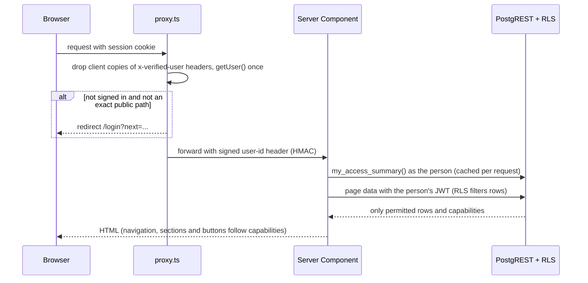

Public: `/login`, `/forgot-password`, `/reset-password` (redirect), `/auth/callback`, `/api/health`, `/api/version` and image files at `public/` top level and `public/brand/` (`proxy.ts`). Sign-in: GoTrue password, no public sign-up, forced password change while `must_reset_password`, failed sign-ins limited per IP + e-mail for 15 minutes in-process (`lib/actions/auth.ts`; with `TRUSTED_PROXY_HOPS` unset all clients share one counter — denial-of-service risk until D-11).

### 6.2 Administrator grant with preview (BUILT, P2-3)

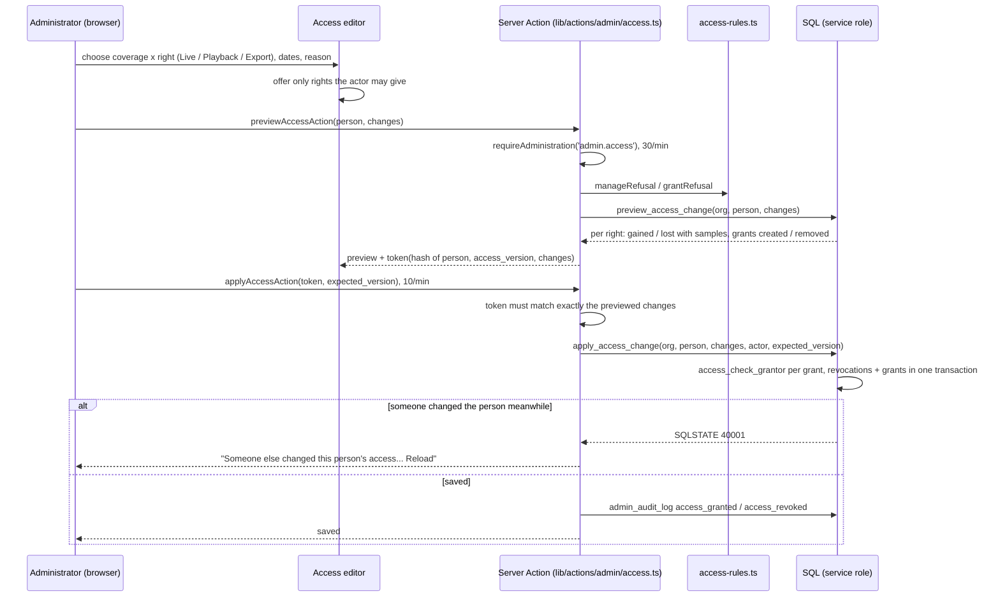

Open sessions of the person are not touched yet (P2-4).

### 6.3 Live video (BUILT; awaiting hardware validation)

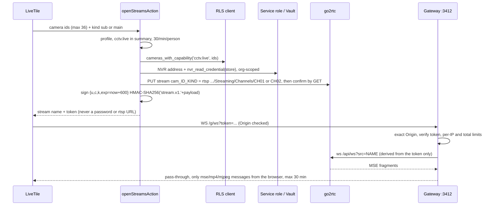

Properties (verified: `lib/streams/token.ts`, `lib/streams/gateway.ts`, `lib/streams/go2rtc.ts`): token keys exactly `u,c,k,exp` (+`s,e` for playback), lifetime enforced at verify, ≥ 16-character secret; refusal (close 1008) before any upstream connection; limits 240 upgrades/min/IP, 100 sockets/IP, 300 total, 4 MB browser payload, backpressure cut-off; go2rtc error text replaced by fixed sentences; go2rtc's `PUT/DELETE` status codes are not trusted (it answers 400 yet applies the change with a read-only config), so every change is confirmed with `GET /api/streams`; identical re-registration skipped; idle `cam_*`/`pb_*` streams pruned by strict name patterns, never with consumers. The client pauses hidden tabs and replaces tokens on renewal (`components/live/useOpenedStreams.ts`). The player script is loaded from the gateway origin (`/g/video-stream.js`), which matters for the CSP (D-12 vendors it).

### 6.4 Recorded playback, 1× (BUILT; awaiting hardware validation)

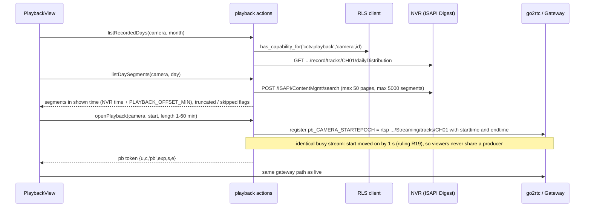

One global `PLAYBACK_OFFSET_MIN` (`lib/actions/playback.ts`) handles NVR clocks; per-recorder measured offsets and true UTC are D-17 (P4-L2 / WP-4.3). Recordings crossing midnight are tested against the fake NVR only.

### 6.5 Fast playback today and the D-L1 target

Today (BUILT, fakes only): `GET /api/vod` (`app/api/vod/route.ts`, `lib/streams/vod.ts`) needs `cctv.export` AND `cctv.playback`; downloads the recording from the NVR (`/ISAPI/ContentMgmt/download`), pipes it through ffmpeg without re-encoding (`-protocol_whitelist pipe`, `-format_whitelist mpeg,mpegts,mov,mp4,h264,hevc`) into a fragmented MP4 for a plain `<video>` at 2×/4×/8×; 1 conversion per person, 8 in all (in-process); a new one ends the previous one; killed on page close, after 30 minutes or after 60 s of NVR silence; audited start/end/denied. ffmpeg is not installed on the development host, so the real-ffmpeg test is skipped and nothing has been played end to end.

Target (ruling D-L1, P4-L2 PLANNED): fast playback (2×-16×) becomes a `cctv.playback` right delivered **only** as a non-downloadable stream through the gateway/MSE path (same session registry, ≤ 60 s revocation, concurrency caps, audit), with chunked prefetch and stall downshift; saveable files move to export jobs that require `cctv.export` (D-6, P4-L4). This supersedes D-6a and the current `/api/vod` rule. Until P4-L2 lands, `/api/vod` returns a savable MP4 and therefore keeps requiring `cctv.export`.

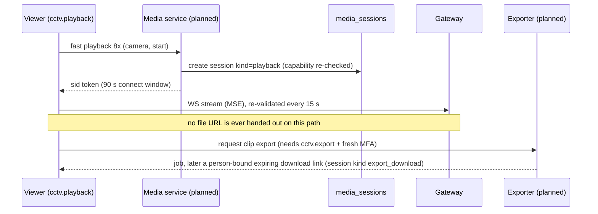

### 6.6 Session revocation (PLANNED, P2-4)

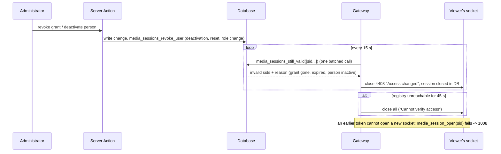

### 6.7 Monitoring state machine (BUILT) and check-now (BUILT)

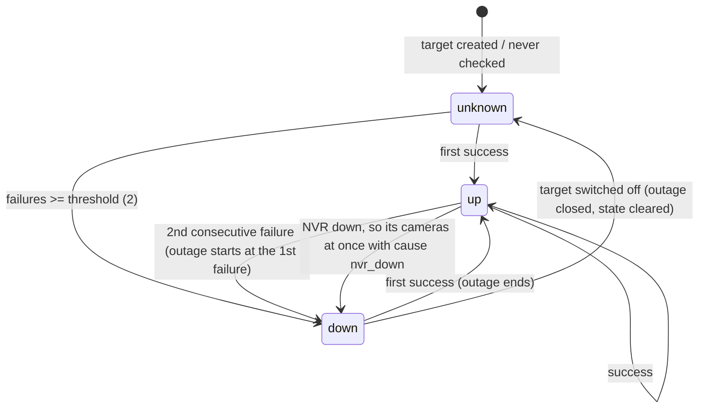

`monitor_apply_results` (`supabase/migrations/20261021000006_monitoring_fixes.sql`) applies batches atomically; only the service role may call it; a failure left from before a worker stop is discarded when a recorded gap overlaps the silent period; results for switched-off targets are ignored. Display: Live / Offline / Not checked yet / Not checked lately (last good result older than 20 minutes, excluded from Live counts).

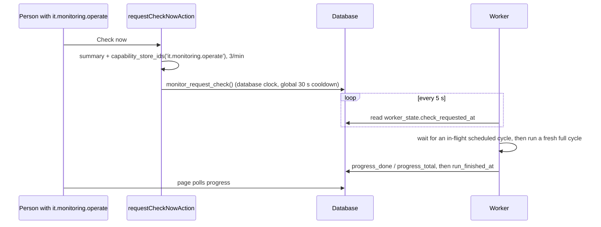

The check covers every target of every organisation (one global `worker_state` row), not only the requester's locations.

### 6.8 Worker lease (PLANNED, P2-7, D-8)

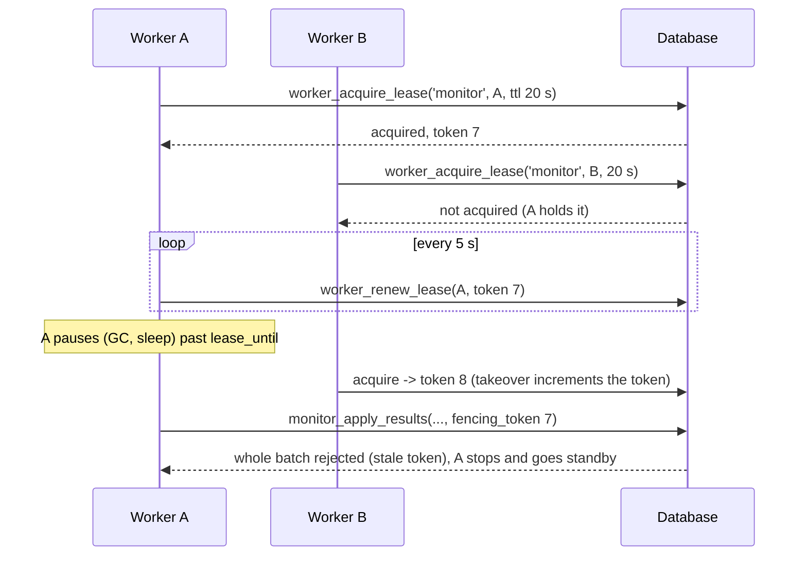

Also planned: SQL guard skipping results older than `last_checked_at`; check-now requests surviving a takeover; lease names per shard (`monitor:shard-n`).

### 6.9 Agent check-in and signed command (PLANNED, WP-6.1 / WP-7.1, D-9)

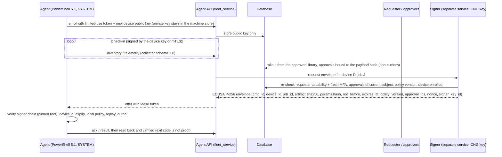

A compromised device key can report data but cannot create, approve or sign commands. The engine that drives offers, leases, reconciliation and verification is BUILT in memory (section 7.4); the agent, API, signer and database store are not.

### 6.10 Wi-Fi rollout (PLANNED; orchestration core BUILT with fakes)

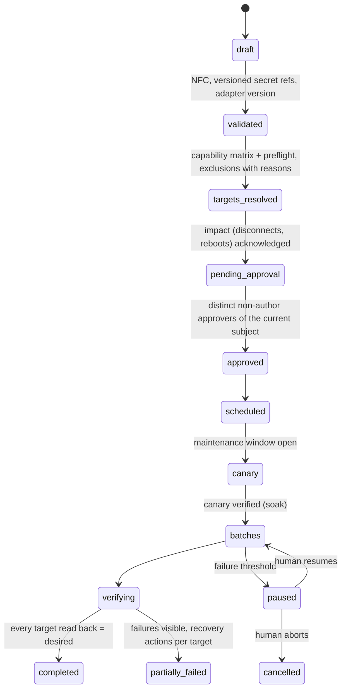

Per location normally one AP at a time; jobs of an AP that was offline are revalidated on return and superseded if a newer rollout started; a manual change on one AP is reported as drift, never copied to others. Every NETGEAR operation stays refused until a `lab_validated` adapter exists (W-2; research found no documented configuration API for standalone mode).

---

## 7. Monitoring design

### 7.1 Current behaviour (BUILT; awaiting hardware validation)

| Target | Method (`lib/monitor/checks.ts`, `lib/probes.ts`) | Interval (`lib/monitor/config.ts`) |
|---|---|---|
| Devices (servers, attendance, footfall, other) | TCP connect to `tcp_port`, or ICMP ping (success needs `TTL=` in the output and exit code 0, because Windows `ping` can print "Destination host unreachable" with exit 0) | 60 s (`DEVICE_CHECK_SEC`) |
| NVR reachability | TCP connect to the RTSP port | 60 s |
| Cameras of a store | ISAPI `InputProxy/channels/status` (Digest); cameras not reported online re-checked with RTSP DESCRIBE on the sub-stream (200 live, 401 reachable but refused) | 300 s (`CAMERA_CHECK_SEC`) |

Worker design (`lib/monitor/runner.ts`, `supabase-db.ts`; P2-5b: per recorder, `docs/drishti/locations-model.md` §11): per-target lanes so a late result never overwrites a newer one (in-process only); one job per monitored NVR (recorder) with the cameras of its active channel mappings, 10 NVRs at a time (`RECORDER_CONCURRENCY`, old name `STORE_CONCURRENCY` accepted), 4 RTSP checks per NVR, 50 devices at a time; heartbeat every 5 s on its own timer; silent periods recorded as gaps; NVR login refused or no saved password → **no camera results** for that NVR and a 15-minute back-off of that NVR only (`NVR_LOGIN_BACKOFF_SEC`, in memory, lost on restart) to avoid account lock-out; camera discovery (admin action) is per NVR, matches cameras by (recorder, channel) and lists what it cannot place for reconciliation instead of creating a second camera; it never probes NVR-reported camera addresses. Uptime 24 h/7 d/30 d excludes monitoring gaps and pre-first-check time (`targets_uptime`); a stopped monitor shows "Monitoring is not running" and "No data", not downtime.

Known divergences from the directive (all tracked): an NVR that is unreachable marks all its cameras **down** with cause `nvr_down` and they are counted as down cameras (MC-4; tests assert today's behaviour and will be replaced); no WAN/location correlation; parent-caused downtime counts as downtime; no unknown-time or coverage figure; no recording-health, storage, clock-drift, decode or frozen-frame checks; no SD-WAN, SNMP, attendance/footfall freshness; no maintenance; no alerts.

### 7.2 Planned observation-state model (WP-4.1, D-5, D-7)

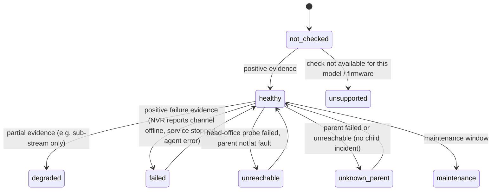

The worker evaluates in dependency order: location uplink, then switch, then recorder or endpoint, then cameras. `stale` is computed when read (no fresh result in the freshness window). Each camera gets three facets with their own state — reachability, stream availability (RTSP/decode), recording health (NVR record status, HDD) — shown separately (CC-16). Incidents replace outages with a `parent_incident_id`; one location or WAN incident suppresses duplicate child notifications while child observations are kept (MC-5, WF-14). Availability is reported over observed time, with unknown time (parent, maintenance, stale, gap) and coverage reported separately — never counted as healthy or down (MC-6). Unsupported checks show "unsupported", never a healthy default (MC-13). Recording health over ISAPI (storage, record status, gaps, retention, drift) is WP-5.2; SD-WAN, SNMP read-only for switch/AP/PoE/UPS/printer and attendance/footfall freshness are WP-5.3 and depend on external access (section 12).

### 7.3 Endpoint telemetry (collector BUILT; agent PLANNED)

`agent/windows/collector/Collect-DrishtiInventory.ps1` (schema `docs/drishti/agent-telemetry-schema.json` 1.0) collects host, OS, hardware, network, software, required services, security, updates and performance as one JSON document; read-only and network-free by construction (static allow-list scan in `tests/unit/agent-collect.test.ts`, 32 tests, mutation-checked); unreadable values are `unavailable` with a reason; `-Redact` hashes names, serials and MACs. Verified as a standard user on one workgroup PC only; domain-joined, elevated/SYSTEM, BitLocker-on, server and Windows 10 cases are unverified (EA-2b). Nothing schedules, sends, stores or displays it yet.

### 7.4 Job and rollout engine (BUILT in memory, fakes only; P7-0)

`lib/jobs/**` (`docs/drishti/job-engine.md`) is a deterministic TypeScript state machine with injected store, clock and ids, shared by fleet changes and Wi-Fi rollouts (W-3). It provides: SHA-256 payload hash over canonical NFC JSON (secrets only as versioned vault references; adapter version inside the hash); per-target effective hashes; approvals bound to an approval subject with revision (A→B→A amendments and re-resolution never revive an approval; no author may approve; effective risk cannot be lowered); offering lease with fencing and guarded commits (concurrency caps hold under concurrent callers); lease tokens stored only as hashes; lost acknowledgement → `unknown` → reconciliation (never a blind rerun) with backoff and `needs_manual`; verification separate from apply (`accepted_but_not_verified` never counts as verified); revalidation on return; supersession when a newer rollout starts; canaries, per-location and global caps, windows (IANA zones, across midnight, DST), pause/resume/cancel, failure thresholds; snapshot restore as its own approved rollout. Evidence: 14 test files, 286 tests including a seeded property test (300 random worlds by default, 2000 with `JOBS_PROPERTY_RUNS=2000`). Missing: PostgreSQL store (partial unique index for one active job per target, CAS versions, fencing lease rows), agent API, signer, screens, any real adapter.

---

## 8. Security model

### 8.1 Secrets and Vault (BUILT, with gaps)

NVR passwords live only in Vault (`nvr_store_credential` / `nvr_read_credential` / `nvr_delete_credential`, service role only), read at use time and never stored in tables, logs or responses; signed-in people cannot read NVR address/login columns, the Vault id or camera addresses (column grants + IT-view views). App secrets per purpose with a 16-character minimum (`stream_token`, `cron`, `worker`, `system_log_ingest`; the last three have no consumer yet); `npm run env:local` generates them into `.env.local`; demo passwords are random and printed once. Gaps: no rotation procedure or key ids (P2-6, SO-6); the service-role key also signs the proxy header; Vault/pgsodium root key backup and restore untested (WP-5.4, SO-13); rollbacks do not delete Vault secrets.

### 8.2 Tokens

Stream tokens: HMAC-SHA256, domain-separated (`stream.v1.`), one person / camera / kind, 10-minute connect window (+60 s skew), exact key set, constant-time comparison, never throws (`lib/streams/token.ts`). Planned: `sid` claim and 90 s window (P2-4); key ids for rotation. The tokens travel in the WebSocket query string over plain WS today (TLS planned). Job-engine lease tokens are stored as hashes. Agent and command tokens: section 6.9 (PLANNED).

### 8.3 Gateway

Exact path and Origin allow-list (`GATEWAY_ALLOWED_ORIGINS`), token check before any upstream connection, stream name derived only from the token, message-type allow-list, per-IP and total limits, slow-request timeouts, security headers, CORS only for allowed origins on the two player scripts, fixed error sentences. Binds `0.0.0.0` over plain HTTP/WS; performs **no database or permission check** and has no revocation path (P2-4).

### 8.4 go2rtc review (SO-9 partial; D-13 PLANNED)

| Item | Today (`deploy/*`) | Planned (D-13) |
|---|---|---|
| API 1984 | published on `127.0.0.1` only; **no credentials**; supports `exec:`/`ffmpeg:` sources | API credentials from a dedicated secret; only the media service registers; only `rtsp://` sources whose host:port is a registered recorder endpoint (plus the dev demo source) |
| WebRTC 8555 tcp/udp | enabled and published on `127.0.0.1` though unused | `webrtc: listen: ""`, no publish |
| RTSP 8554 | off in `go2rtc.yaml`; on in the demo config inside the container loopback only | unchanged (demo only) |
| Other modules (srtp, rtmp, homekit, hass) | defaults of 1.9.9 not reviewed | disabled explicitly; verified by `GET /api/config` and socket listing in an integration test |
| Container | digest-pinned 1.9.9, `cap_drop: ALL`, `no-new-privileges`, read-only config | separate media service, never sharing a host process with fleet execution |

### 8.5 Outbound connections and egress

There is no registered-target restriction yet: any syntactically valid host is accepted by the probes (`lib/probes.ts` `isValidHost`), including loopback and link-local (SO-4). Planned (`lib/security/targets.ts`, P2-6): one module every outbound connection must use (probes, NVR client, RTSP, discovery, go2rtc registration, ffmpeg downloads, later SNMP/WinRM/SSH/VNC) allowing only registered endpoints, refusing loopback/link-local/metadata ranges outside demo mode, pinning DNS answers, refusing `exec:`/`ffmpeg:` source strings.

### 8.6 Rate limits

In-process only (`lib/rate-limit.ts` via `processSingleton`, `lib/streams/request-limit.ts`, `lib/streams/limiter.ts`): sign-in, forgot password, check-now 3/min, user administration 30/min, access preview 30/min / save 10/min / review 30/min, the four video counts (section 5.6), fast playback 1 per person / 8 total. Inventory, import, discovery and group actions have no limit. Several app processes would each allow the full rate. Planned: database-backed `rate_limit_hit(key, limit, window)` with an in-process first filter and rising sign-in delays by e-mail + IP (D-11, P2-6).

### 8.7 Test egress guard

`tests/setup/egress-guard.ts` (loaded for every test) refuses any non-loopback TCP connection and any `ping`/`tracert` to a non-loopback address through every `child_process` entry point; integration tests also assert they run against the local stack. Not covered (documented): UDP, `dns.*`, custom `lookup`.

### 8.8 Headers, CSP and MFA

`next.config.ts` sets `nosniff`, `X-Frame-Options: SAMEORIGIN`, `Referrer-Policy`, `Permissions-Policy`, HSTS only when the app URL is HTTPS. **No Content-Security-Policy** (SO-8). Planned D-12 (WP-3.4): per-request nonce set in `proxy.ts`, vendored go2rtc player scripts with SRI so `script-src 'self' 'nonce-…' 'strict-dynamic'` needs no cross-origin host, `connect-src 'self' wss://<gateway>`, `media-src 'self' blob:`, `object-src 'none'`, `frame-ancestors 'none'`, report endpoint, verified with the real player in a browser. MFA: section 5.9. TLS for app and gateway: WP-5.4, needs certificates (external dependency).

### 8.9 Audit

Today `admin_audit_log` receives best-effort rows (a failed insert is only logged, `lib/admin/audit.ts`) for administration, access changes, CCTV opens/searches/exports, check-now, discovery and groups; the service role can modify it; gateway sessions are only stdout lines. Planned D-15 (WP-5.4): append-only `audit_events` with per-organisation hash chain, hourly signed checkpoints outside the database, a verifier, and fail-closed writes for exports, grants and fleet actions.

### 8.10 Database hygiene

Closed default privileges and explicit grants; `privilege_violations()` asserted empty (relations only); every migration since 0009 rolled back in a rolled-back transaction during its package with `privilege_violations()` empty, and `npx supabase db diff --local --schema public` showed no drift with all sixteen migrations (Evidence log, P2-3). `monitor_apply_results` casts ids without a guard, so one malformed element aborts a whole batch (validation is in TypeScript).

---

## 9. Design system and branding

- **Tokens** (BUILT, P3-0): `app/globals.css` `:root` holds the CityKart Asset Management OKLCH values plus Drishti field tokens; measured contrast in `docs/design/drishti-tokens.md` and enforced by `tests/unit/field-contrast.test.ts` (field edge 3.64:1 on white, 3.19:1 on the page canvas; focus ring 2 px at 7.17:1; placeholder 5.98:1; disabled text 5.26:1). The earlier invisible-field cause (1.22:1 edges) is gone. **One light theme only**: the dark theme was removed because it made fields 1.38:1. Weak pairs (`--success`, `--warning`, `--info` on white) are documented as not for text.
- **Fields**: one skin for Input, Select, Textarea, PasswordInput, Checkbox (`components/ui/*`, `fieldClasses`), base-layer styling for every native control, labels bound, announced errors (`tests/unit/ui-fields.test.tsx`).
- **Logo rules** (BUILT, BR-3/BR-4): the full transparent logo `public/brand/citykart-drishti-logo.png` (1851×849, plus `-925` and `-462` for `srcset`) on every authentication page, the expanded sidebar and the not-found page, through `components/layout/BrandLogo.tsx`: aspect ratio preserved (one fixed dimension), never cropped, recoloured, filtered, stretched, placed on a plate or replaced by text (tested in `tests/unit/brand.test.tsx`; PNG alpha and transparent corners in `tests/unit/brand-assets.test.ts`). The icon-only mark (`citykart-drishti-mark-{32,64,180,256,512}.png`) is used only in the phone top bar below the `md` breakpoint and as favicons (`app/icon.png` = mark-32, `app/icon1.png` = mark-64, `app/apple-icon.png` = mark-180). `proxy.ts` serves `/brand/*.png` before sign-in.
- **Name**: "CityKart Drishti", short "CKDRISHTI" (`lib/brand.ts`; browser title `%s — CityKart Drishti`); brand fixed (D-L2); English only (D-L3).
- **Not done** (BR-1/BR-2 partial, VA-11): visual parity with Asset Management is **not claimed** (the reference was inspected from code, tokens and stored screenshots, not rendered live — the one missing item, R14); Inter / IBM Plex Mono fonts, collapsible icon-rail sidebar, card/badge/table/dialog contracts (WP-3.1); seven bare native `<select>`s; a page-by-page signed-in review at 1366×768, 1920×1080 and 2560×1440 (WP-3.5).

---

## 10. Testing and quality process

**Process.** Each work package is built by a fresh AI sub-agent test-first (tests seen failing), then reviewed by an independent reviewer (opus for security, SQL and concurrency), with fix rounds until accepted; key tests are checked by mutation (a deliberate code change must fail them); the package updates its tracker rows and appends to the Evidence log in `docs/drishti/DELIVERY-STATUS.md`; reports live in `.superpowers/sdd/drishti/*-report.md`. Old-behaviour tests are replaced with a comment naming the directive requirement, never weakened. Gates per package: typecheck, lint, unit, integration, build (UI/route packages).

**Latest recorded evidence** (Evidence log, P2-3, commit `78fd7d8`): `npm run typecheck` 0 errors; `npm run lint` 0 problems; `JOBS_PROPERTY_RUNS=200 npm run test:unit` 94 files, **1,358 passed**; `npm run test:integration` 38 files, **457 passed, 1 skipped** (the real-ffmpeg test; ffmpeg not installed), 86 s; `npm run build` success. Job engine alone (P7-0 review round 1): 14 files, 286 passed; `JOBS_PROPERTY_RUNS=2000` property run passed. Collector: 32 passed (Windows only). Commit `0a33411` (dev-admin script, 7 lines) has no separate recorded run. Neither suite was re-run for this document.

**What the suites prove**: permission boundaries per person × operation (`tests/integration/capability-enforcement.test.ts`: 12 operations × 12 people incl. other location, expired, future, revoked mid-test, deactivated, role-only — refusal shape and zero NVR/go2rtc requests); RLS for every table and view; grant rules, preview = save, lost-update protection; migration equality; monitoring state machine and gaps; gateway behaviour against fake go2rtc; NVR client against a fake Digest ISAPI server; playback paging and midnight; job orchestration invariants. **What they do not prove**: anything about a real Hikvision NVR, real cameras, codecs in real browsers, real ffmpeg, SD-WAN behaviour, real Windows fleets or NETGEAR APs (section 12); load beyond the access-function benchmark; browser journeys (only P2-3 and P3-0 screenshot sets exist under `docs/drishti/evidence/`).

**How to re-run** (needs Node 20+ and Docker; the local stack must be running for integration tests, with no worker, gateway or dev job writing to the same database except the owner's dev server):

```
npm run db:start
npm run typecheck
npm run lint
npm run test:unit                      # JOBS_PROPERTY_RUNS=200 shortens the property test
npm run test:integration
npm run build
npx vitest run tests/unit/jobs-*.test.ts
npx supabase db diff --local --schema public   # schema drift check
```

---

## 11. Build status and branch map

The requirement-level status is the tracker (`docs/drishti/DELIVERY-STATUS.md`, 194 rows; today 21 implemented and locally verified, 5 awaiting hardware validation, 76 partial, 9 blocked by an external dependency, 83 not implemented — counted with the tracker's own grep). This section gives the structure only.

### 11.1 Branches (local, stacked, never pushed)

| Branch | Tip | Content |
|---|---|---|
| `main` | `9ad34d1` | 2 documentation commits |
| `feat/plan-1-foundation` | `fe6d362` | Plan 1 (+23): project, auth, roles, grants, users admin, stores/cameras/devices, CSV import, RLS tests |
| `feat/plan-2-monitoring` | `60db30f` | Plan 2 (+25): probes, state machine, uptime, worker, discovery, check-now, status UI, demo tools |
| `feat/plan-3-live-feeds` | `8bdc09c` (frozen) | Plan 3 (+23): camera groups, stream tokens, go2rtc client, gateway, live wall, recording search, playback screen, fast playback (`3fc5c1f`, fix `a01fa5a`), Drishti directive/audit/decisions/tracker docs; Task 9 folded into the Drishti handover |
| `feat/drishti-p2-access-location` | `0a33411` (current) | Drishti (+15) — see 11.2 |

### 11.2 Drishti phases and work packages

| Phase / package | Content | State |
|---|---|---|
| P1 audit and design | audit, rework proposal, design reference, decisions, tracker | BUILT (docs) |
| P2-1 access model (WP-2.1 DB) | migrations 0008-0012, `e4c6e76`, `ea80ba9` | BUILT, reviewed |
| P2-2 enforcement | migrations 0013-0014, `34b8809`, `3fe957a` | BUILT, reviewed |
| P2-3 access administration | migrations 0015-0016, `78fd7d8`, docs `ce55736`, `0a33411` | BUILT; **independent review in progress** |
| T-1 Store → Location wording and routes | `t1-brief.md` (after P2-3) | PLANNED |
| P2-4 session registry, ≤ 60 s revocation (WP-2.2) | `p2-4-brief.md` | PLANNED |
| P2-5a/b/c locations, assets, recorders, mappings, network definitions, Wi-Fi inventory, import + discover-all (WP-2.3) | `p2-5-brief.md` | PLANNED |
| P2-6 credential/SQL hardening, service roles, outbound restriction, shared rate limits (WP-2.4, D-11, D-14) | `p2-6-brief.md` | PLANNED |
| P2-7 worker lease and fencing (WP-2.5) | `p2-7-brief.md` | PLANNED |
| P3-0 brand quick pass | `eef5b3b` | BUILT |
| P3 shell, auth, MFA, CSP, visual QA (WP-3.1…3.5) | — | PLANNED |
| P4 observation states, control centre, CCTV completion (offsets, exports, media service), codec matrix; legacy parity P4-L1…L5 | — | PLANNED |
| P5 alerts, recording health, topology, operational readiness (TLS, durable audit, backup/restore, packaging) | — | PLANNED |
| P6 read-only agent: collector P6-2a | `087d20e` | BUILT (collector only); enrolment, transport, ingest PLANNED |
| P7 controlled remote and fleet (+ Wi-Fi rollouts): engine core P7-0 | `52897e2`, `2d014e9` | BUILT in memory (fakes); database store, agent API, signer, actions, remote screen PLANNED |
| P8 lab Windows deployment | — | PLANNED (lab-blocked) |

Working tree at writing: `docs/drishti/DECISIONS.md` and `DELIVERY-STATUS.md` have uncommitted coordinator edits (the "Legacy parity" section and rulings D-L1…D-L4); `LEGACY-HANDOFF-GAP-ANALYSIS.md`, `wifi-capability-research.md` and `docs/reference/cctv-hub-handoff-2026-10-21.md` are untracked.

---

## 12. Known limitations, unverified behaviour, external dependencies

### 12.1 Limitations of the built parts

1. One NVR per store row; camera identity tied to `(store_id, channel)`; deleting a camera erases its monitoring state (P2-5).
2. Open video survives revocation and deactivation for up to about 41 minutes (P2-4).
3. MFA disabled; no fresh authentication (P3).
4. NVR-down marks cameras down; no unreachable/unknown/maintenance states; no recording health (WP-4.1, WP-5.2).
5. Heartbeat-only worker guard with race windows; check-now global across organisations; late-result guard and NVR back-off in memory only (P2-7).
6. Single service-role key in every process; no outbound target restriction; go2rtc API without credentials and an unused WebRTC listener; `search_path = public` on early functions; `privilege_violations()` blind to functions (P2-6).
7. Plain HTTP/WS; app on all interfaces, gateway on `0.0.0.0`; no CSP (P3, WP-5.4).
8. In-process rate limits; inventory/import/discovery unlimited (P2-6).
9. Best-effort, mutable audit (WP-5.4).
10. Fast playback returns a savable MP4 (contrary to the D-L1 target) and runs ffmpeg inside the web process (P4-L2, WP-4.3).
11. Group names unique per organisation leak the existence of a hidden group's name (AC-11).
12. One global playback clock offset; no per-recorder offset or drift (D-17).
13. Not packaged for production: `tsx` (a dev dependency) runs the worker and gateway; no Windows services, no tested backup/restore.
14. UI and routes still say "store" (T-1 pending); no reports area, Excel export, tour mode, 5×5 grid, timeline zoom or multi-camera playback (legacy parity LG-*).

### 12.2 Behaviour never validated on real hardware

Hikvision ISAPI variants across firmware (search paging, times without `Z`, `dailyDistribution`, `ContentMgmt/download` format, MPEG-PS wrapping); RTSP sub/main paths and `tracks` playback `endtime` behaviour on a real NVR; H.265 main streams in Chrome/Edge/Firefox/Safari (MSE on iOS < 17.1 shows "Video is not available"); ffmpeg rewrap and browser playback at 2×-8×; recordings crossing midnight; real NVR login lock-out thresholds; camera check accuracy (legacy saw about one suspicious offline camera per store); monitoring round duration at fleet scale against the 20-minute stale threshold; collector on domain-joined, elevated, SYSTEM, BitLocker-on, server and Windows 10 machines; every NETGEAR operation (SNMPv3 read path has a documented "only through snmpwalk" issue on 12.5.x-12.8.x firmware; management-mode change wipes configuration).

### 12.3 External dependencies (from proposal §9.7 and the tracker)

1. **SD-WAN** addressing plan (unique routed ranges or overlapping with NAT/VRF), edge monitoring access (SNMP or vendor API), tunnel/failover telemetry — blocks AL-6, MC-9, multi-space addressing.
2. **Lab Hikvision NVR** (ideally a second firmware/vendor) with cameras including H.265; the estate's firmware versions — blocks hardware validation of CC-1, CC-3, CC-5, CC-8, CC-15, LG-25.
3. **Alert channels**: SMTP relay, Teams/webhook endpoints, WhatsApp provider and approved templates (if wanted); all disabled in development.
4. **TLS certificates** (internal CA or public) for app and gateway host names.
5. **Domain/Entra join inventory**, Windows LAPS eligibility, workgroup credential policy.
6. **Lab Windows 10/11 endpoints** (domain and workgroup, one BitLocker-on, one SYSTEM run) and a hub server specification.
7. **Attendance and footfall** integrations (APIs or freshness sources).
8. **NETGEAR**: the estate's exact AP models, firmware and management mode, NETGEAR Insight account/licence/partner status, model-matched MIBs, and explicit owner authorisation for a hardware pilot.
9. **Real estate data** (ruling D-L4 open): the owner's CSV or a copy of the legacy SQL Server `stores` / `cameras` / `cam_groups` / `app_users` tables; without it Drishti holds demo data only.
10. **Design reference**: a live signed-in Asset Management session to compare against (R14).

---

## 13. Readiness statement (2026-10-22)

| Level | Answer | Evidence |
|---|---|---|
| **Locally functional** | **Yes, for the demo stack.** With `db:start`, `demo:seed`, `fake:nvr`, `stack:up:demo`, `gateway`, `worker` and `dev`, a person can sign in, see only what their grants allow, watch the generated test picture on the live wall, browse the fake NVR's recordings and play them back, edit camera groups, run check-now, and an administrator can grant and revoke rights with a preview. | Recorded gates at `78fd7d8` (section 10); screenshots `docs/drishti/evidence/p2-3/`, `p3-0/`. The dev server on 3212 is reported running by the ledger; not re-checked here. |
| **Supervised pilot (one real location, real people)** | **No — not ready.** | See the blockers below. |
| **Production** | **No.** | All pilot blockers plus durable audit, backup/restore, packaging, alerts, load tests. |

Pilot blockers, each a named package:

1. **Revocation**: removing a person's access does not stop video they already opened (P2-4; directive target ≤ 60 s, tested).
2. **Real data model**: one NVR per store; locations with several NVRs, head office without an NVR and stable camera identity across remaps do not exist; the real estate is not imported (P2-5; D-L4).
3. **Hardening required "before any real pilot"** by the directive: MFA and fresh authentication for privileged people (P3), per-service least privilege and closed outbound targets (P2-6), go2rtc API credentials and listener review (D-13), shared rate limits (D-11), CSP (D-12), TLS for app and gateway (external certificates), atomic worker lease (P2-7).
4. **Honest monitoring**: NVR or WAN loss is reported as camera failure (WP-4.1) — a pilot would produce misleading outage figures.
5. **No real-hardware evidence at all**: ISAPI, RTSP, browser codecs and ffmpeg have only met fakes; a lab NVR with cameras (external dependency 2) is needed before people rely on it.
6. **Fast playback rights**: today's savable-MP4 path contradicts the accepted D-L1 rule (P4-L2).
7. **Network exposure in development**: app and gateway listen on all interfaces over HTTP; dev data is reachable over the VPN until an explicit bind is configured (R10).

---

## 14. Repository map

```
app/(auth)/                      login, forgot-password, reset-password (redirect), change-password; AuthCard, full logo
app/(app)/                       home, stores, stores/[id], devices, live, playback, groups, groups/[id], error
app/(app)/admin/                 users, users/[id]/access (access editor), access-review, stores, devices, import, monitoring
app/api/                         health, version, vod (fast playback)
app/auth/callback/               password-reset code exchange
proxy.ts                         session check, signed user header, exact public allow-list
components/admin/                AccessEditor, AccessBuilder, AccessPreviewPanel, AccessGrantTable, AccessReviewList, user/store/device forms
components/live/                 LiveWall, LiveTile, useOpenedStreams, PlaybackView, DayCalendar, DayTimeline, PlaybackPlayer, FastPlayer
components/groups|monitor|layout|ui/   group editor; status badge, check-now, find cameras; shell, sidebar, BrandLogo; field-skinned UI kit
lib/auth/                        profile (summary), capabilities, resource (per-resource checks), access-audit, verified-user, safe-next
lib/admin/                       users, access, access-rules (grant rules), roles, audit
lib/actions/                     Server Actions: auth, streams, playback, groups, monitor, admin/{users,access,inventory,monitoring}
lib/streams/                     token, go2rtc client, source builders, open, playback, vod, speed, gateway, limiters, timeline, calendar, wall, thumbnail
lib/nvr/ lib/rtsp/ lib/probes.ts Digest client, ISAPI parsers, recording search; RTSP DESCRIBE; TCP/ICMP probes
lib/monitor/                     runner, checks, config, guard (heartbeat), health, check-now, discovery, uptime, supabase-db
lib/queries/ lib/inventory/ lib/import/ lib/groups/   read models; store/device services; CSV import; group service
lib/jobs/                        rollout/job engine (in memory), canonical hashing, approvals, planner, windows, fake adapter (test only)
lib/security/ lib/observability/ lib/design/   org scope; logger, masking, error sanitising; contrast computation
services/gateway, services/worker   process entry points
agent/windows/collector/         read-only PowerShell inventory collector
supabase/migrations|rollback/    0001-0016 forward + rollback; config.toml (ports, auth, MFA off); seed.sql
deploy/                          go2rtc compose and configs (normal, demo)
scripts/                         create-dev-admin, env-from-supabase, fake-nvr, seed-demo
tests/unit|integration|helpers|setup/   94 unit and 38 integration files; fake servers; egress guard
types/database.ts                generated database types
public/brand/                    full logo (3 sizes) and mark (5 sizes)
docs/drishti/                    directive, supplement, decisions, tracker, this document, access model, job engine, telemetry, research, evidence/
docs/audit/  docs/design/        initial audit, rework proposal; Asset Management reference, tokens, reference screenshots
docs/superpowers/specs|plans/    pre-directive spec and Plans 1-8 (design history; superseded where the directive differs)
reference/cctv-hub-legacy/       legacy hub source (read-only)
.superpowers/sdd/                builder ledgers, briefs, reports, review diffs
```
