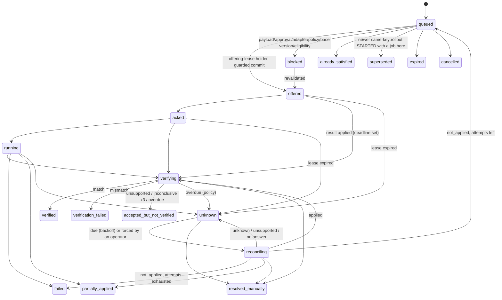

# Rollout and job orchestration engine (P7-0)

Shared core for endpoint fleet changes (software, scripts, configuration, patches) and Wi-Fi configuration rollouts (DECISIONS W-3). It is a deterministic state-machine library in TypeScript with an injected persistence interface, an injected clock and id generator, and an in-memory store for tests. Later packages persist it in PostgreSQL (P7-1/P7-2, Wi-Fi rollout package) and drive it from the worker and the agent API.

**Status: orchestration verified with fakes only.** No database, no agent, no screen, no real adapter exists yet. The fake adapter proves orchestration; it proves nothing about how a NETGEAR AP or a Windows PC behaves. Nothing in this package may be cited as real-device validation. Revised after the independent review (round 1); the changes are listed at the end.

## Files

| File | What it holds |
|---|---|
| `lib/jobs/canonical.ts` | Canonical JSON (`canonicalize`), strict JSON reader (`parseJsonStrict`, refuses duplicate keys), `findNonNfc`, `sha256Hex` |
| `lib/jobs/plan.ts` | `payloadHash(plan)`, `validatePlan` (NFC, versioned secret references, adapter version, derived setting paths, horizon), own-property lookups |
| `lib/jobs/approvals.ts` | Approval rules per risk level, approval subject, effective-risk helpers, `evaluateApprovals`, `checkNewApproval` |
| `lib/jobs/window.ts` | Zone-explicit instants and maintenance windows |
| `lib/jobs/machines.ts` | Rollout and job transition tables and state sets |
| `lib/jobs/paths.ts` | Setting-path overlap |
| `lib/jobs/planner.ts` | Target order, canary/batch assignment, thresholds, summary, final state, recovery actions |
| `lib/jobs/store.ts` | `JobStore` interface (atomic commit with record CAS, guards, counter slots, fencing leases; append-only events) and `InMemoryJobStore` |
| `lib/jobs/engine.ts` | `JobEngine`: rollout lifecycle, offering lease, tick, job protocol, revalidation, supersession, conflicts, escalation, sweeps |
| `lib/jobs/adapter.ts` | `JobAdapter` interface (describeCapabilities incl. `describeSettingPaths`, preflight, snapshot, apply with expected hashes, reconcile, verify, rollback, stop) |
| `lib/jobs/runner.ts` | `RolloutRunner`: push-style driver of hub-side adapters through the engine protocol |
| `lib/jobs/recovery.ts` | `buildRestorePlan`: snapshot restore as its own approved rollout |
| `lib/jobs/redact.ts` | Redaction of details and free text, message cap, lease-token hashing and constant-time comparison |
| `lib/jobs/fake-adapter.ts`, `lib/jobs/testing.ts` | Test-only: scriptable fake adapter (with or without a device journal), fake clock, ids, seeded RNG, builders, world harness, event-log analyser. ESLint `no-restricted-imports` forbids importing them from `app/**` and `components/**` |

## Plan, payload hash, effective hash

A **plan** is the immutable execution payload: kind, adapter and **adapter version**, artifact (id, immutable version, SHA-256), exact parameters, policy version, target-selector snapshot, base configuration version, supersede key, declared setting paths, conflict policy, schedule (`not_before`, window), expiry, canary, batch spec, thresholds, attempts per target, requested risk and requester. The whole plan is hashed:

`payload_hash = SHA-256("drishti.plan.v1\n" + canonicalize(plan))`

Canonical JSON: keys sorted by UTF-16 code units after NFC; NFC strings; lone surrogates, NaN/±Infinity, integers ≥ 2^53, non-plain values, sparse arrays, cycles and depth > 64 refused; `-0` → `0`; undefined properties left out; `parseJsonStrict` also refuses duplicate keys.

**The hash covers exactly what executes.** Because canonical JSON normalises to NFC, a plan whose text is not already NFC is refused at creation, amendment and validation (otherwise two SSIDs that a device treats as different would share one hash). **Secrets** appear only as immutable versioned references `{ ref: "vault:...", version, fingerprint }`; a bare reference (`"vault:wifi/staff"`) or a secret-named parameter with any other value is refused, so the value behind an approval cannot change. The **adapter version** must equal the registered adapter's version; a later adapter change blocks the jobs (`adapter_changed`).

At target resolution every included target gets an **effective hash** `SHA-256("drishti.effective.v1\n" + canonical({payload_hash, target_id, location_id, model, firmware, effective_inputs}))` covering its resolved per-device inputs. It is stored on the job, part of the approval subject, and passed to the adapter with the payload hash (`apply(target, plan, key, {payload_hash, effective_hash})`); the device refuses a plan that does not hash to it.

## Approvals: subject, authors, effective risk

- **Subject.** An approval references the *approval subject* `SHA-256("drishti.approval-subject.v1\n" + canonical({rollout id, revision, payload hash, resolved targets with order, phase and effective hash, exclusions, impact, acknowledgement flag, effective risk}))`. The **revision** grows on every amendment and every target resolution, so A→B→A amendments and re-resolution (1 target approved, 50 resolved later) never revive an approval. Only approvals of the current subject count.
- **Four eyes.** `createRollout` refuses an actor other than the plan's requester; an amendment makes the amender the requester. The rollout keeps the **authors** of the current version (creator, every amender, every target resolver, the submitter); none of them may approve. Distinct approvers per rule.
- **Effective risk** = max(requested risk, the adapter's `min_risk` for the kind, the policy minimum `kind_min_risk`, the impact minimum: disruption, reconnection, reboot or a missing estimate ⇒ at least medium). The requester cannot lower it. Rules per effective risk: low none, medium one, high two (configurable).
- Impact acknowledgement is required from each counted approver when the impact needs it. A rejection cancels. The approver's capability and scope are checked by the calling Server Action.

## Rollout states

```mermaid
stateDiagram-v2
  [*] --> draft
  draft --> validated: validate
  validated --> targets_resolved: resolveTargets (revision+1, subject)
  validated --> draft: amend (revision+1)
  targets_resolved --> pending_approval: submit
  targets_resolved --> approved: submit (effective risk needs none)
  targets_resolved --> draft: amend
  pending_approval --> approved: enough approvals of the current subject
  pending_approval --> draft: amend
  approved --> scheduled: schedule
  approved --> draft: amend
  scheduled --> draft: amend
  scheduled --> running_canary: start (jobs created; older same-key waiting jobs superseded)
  scheduled --> running_batches: start, no canary
  running_canary --> running_batches: canary verified + soak
  running_canary --> paused_by_threshold
  running_batches --> verifying: every batch settled
  running_batches --> paused_by_threshold
  verifying --> paused_by_threshold
  running_canary --> paused
  running_batches --> paused
  verifying --> paused
  paused --> running_canary
  paused --> running_batches
  paused --> verifying
  paused_by_threshold --> running_canary: human decision
  paused_by_threshold --> running_batches: human decision
  paused_by_threshold --> verifying: human decision
  verifying --> completed
  verifying --> completed_manually
  verifying --> partially_failed
  verifying --> failed
  verifying --> superseded
```

Not drawn: every non-terminal state can go to `cancelled`; `targets_resolved` and later can go to `expired` (also when approval takes longer than `max_pending_approval_ms`); the running states can finish directly when all jobs are terminal. Terminal: `completed`, `completed_manually` (every job resolved by hand), `partially_failed`, `failed`, `cancelled`, `superseded`, `expired`. `lib/jobs/machines.ts` is authoritative; unused transitions were removed.

## Job states



Active states (holding the target and counting toward caps): `offered`, `acked`, `running`, `verifying`, `unknown`, `reconciling`.

## Offering is safe by construction

1. **Single writer.** Only `tick(fence)` and `targetReturned(target, fence)` make offers. In one process they run one at a time (engine lock). Across processes, the caller must hold the **offering lease** (`acquireOfferingLease(holder, ttl)` → fence `{name, holder, token, until}`); a takeover after expiry gets a higher fencing token, and the store refuses every commit carrying an older token (`stale_fence`). `targetReturned` does not run a full tick: it revalidates that target's waiting jobs and offers only for that target.
2. **Guarded commits.** Counter slots `target:<id>`, `location:<id>` and `rollout-active:<id>` are bumped whenever a job enters or leaves an active state. An offer reads the slot versions **before** the data it decides on, and its commit is guarded by those versions and by the rollout row version. Two writers that both saw a free location cannot both offer (write skew is refused), and no offer lands after a pause or cancel committed (the rollout row changed). The property test runs a second engine on the same store with the same fence concurrently with the runner and parallel `targetReturned` calls; removing the guards makes it fail.

## Protocol between the hub and adapters

Tokens (lease, reconcile, verification) are returned once to the caller and stored only as SHA-256 hashes; comparison is constant-time; events carry a short fingerprint of the hash.

```mermaid
sequenceDiagram
  participant E as Engine (hub)
  participant D as Device side (agent or AP adapter)
  E->>E: tick(fence): revalidate, caps, guarded offer (token T, lease_until, attempt n)
  E-->>D: offer {job id, idempotency key = job id + payload hash, plan, payload hash, effective hash, T}
  D->>E: recordSnapshot(T, encrypted ref, key ref, content hash, retention)  [where supported / required]
  D->>E: checkBeforeApply(T)  (lease, state, plan integrity, approvals, rollout not ended, snapshot rule)
  D->>E: ack(T), start(T), heartbeat(T) (heartbeat before ack is refused and logged)
  D->>E: reportResult(T, applied | failed | partial | unknown; message redacted, ≤ 512 chars)
  E-->>D: beginVerification → token V (deadline from entering verifying)
  D->>E: recordVerification(V, match | mismatch | inconclusive | unsupported, expected, observed)
  Note over E,D: lost acknowledgement or result: lease runs out, job -> unknown
  E-->>D: beginReconcile (when due) → token R, idempotency key
  D->>E: recordReconcile(R, applied | not_applied | partial | unknown | unsupported)
```

**PowerShell endpoint agent (pull, outbound).** The check-in is the transport. The check-in response carries new offers (signed envelope per D-9: device id, job id, artifact version and hash, exact parameters, payload and effective hash, expiry, policy version, approval ids) plus due reconcile and verification requests. The agent writes the offer to its persistent local journal before `ack`, refuses a plan that does not hash to the envelope, runs it, journals the outcome and reports it on the same or next check-in. Reconcile answers come from the journal by idempotency key, so a job that ran while its acknowledgement was lost is reported `applied` and never runs twice. Verification is the agent's read-back; an exit code alone is never `verified`.

**Wi-Fi AP adapter (push, hub-side).** `RolloutRunner` renews the offering lease each step and passes its fence to `tick`. Per offer: snapshot (a kind with `require_snapshot` fails the job when no snapshot could be taken), `checkBeforeApply`, `apply` with the expected hashes over the wired/SD-WAN management path, then `ack`, `start`, `heartbeat`, `reportResult`. No answer: nothing is re-sent; the lease runs out and the job becomes `unknown`. An AP without a journal reconciles by read-back (does the configuration have what the received plan asked for?). The runner respects `operations.reconcile` (no reconcile call; the job needs a human at once) and `operations.verify` (verification reported as `unsupported`, i.e. accepted but not verified).

## Revalidation (before every offer, and when a target returns)

Order: rollout cancelled → `cancelled`; expiry passed → `expired`; a newer same-key rollout has **started** with a job for the target → `superseded`; stored hash ≠ hash of stored plan, job hash ≠ rollout hash, or job effective hash ≠ resolved effective hash → `blocked(payload_changed)`; approvals of the current subject not satisfied → `blocked(approval_missing)`; adapter missing or version changed → `blocked(adapter_changed)`; policy version changed → `blocked(policy_changed)`; base configuration newer **or unknown** → `blocked(stale_configuration_version)`; target offline, before `not_before`, or window closed → wait; target ineligible → `blocked(ineligible: …)`; desired state already present (read-only probe, cached per target and effective hash for `desired_state_cache_ms`) → `already_satisfied`; otherwise offer.

## Supersession and conflicts

- **Supersession at start.** A newer rollout with the same supersede key supersedes queued and blocked jobs of older ones only when it **starts** and therefore has a job for that target; approval alone supersedes nothing. The superseded job records the superseding rollout and job. If the newer job then ends cancelled or expired without applying anything, both rollouts' summaries list the target in `left_unchanged` ("neither version applied").
- **Conflicts** are decided on the **adapter-derived** setting paths (`describeSettingPaths`); the requester's declaration must be consistent with them (each declared path overlaps a derived one). Different keys with overlapping paths on a shared target: policy `reject` refuses target resolution; policy `wait` records the conflicts. Whatever the policy, conflicting jobs on one target run in rollout order; a job held this way shows `waiting_reason: waiting_for_earlier_rollout:<id>`. A rollout may hold its targets between resolution and approval for at most `max_pending_approval_ms` (default 7 days), then it expires.
- **Stale base version.** Built on N while N+1 exists, or on a key the hub does not know: refused at validation, blocked at revalidation.

## Unknown jobs, verification deadlines, cancel and sweeps

- **Unknown escalation.** Entering `unknown` sets `next_reconcile_at` (immediately the first time, then exponential backoff `reconcile_backoff_ms · 2^(n-1)` up to `reconcile_backoff_max_ms`). After `max_reconcile_attempts`, or when the device answers `unsupported`, or when the adapter cannot reconcile at all, the job gets `needs_manual = true`, a `needs_manual_resolution` event (suitable for an alert), `recovery_actions = ['manual']`, a count in the summary, and no further automatic requests (an operator may still force one).
- **Verification deadline.** A job in `verifying` has a deadline (`verify_deadline_ms`); overdue becomes `accepted_but_not_verified` (reason `verification_overdue`) or, by policy, `unknown`. Verifying and reconciling jobs may be resolved by hand.
- **Cancel** writes the rollout row first (no offer can land afterwards) and then the jobs in batches (`cancel_batch_size`); it is idempotent, and cancelling an already ended rollout repeats the job sweep. Each tick also sweeps waiting jobs of ended rollouts. `releaseHeld` lets an operator release targets still held by unknown, reconciling or verifying jobs of an ended rollout after checking the devices.
- **Thresholds** count failures since the last human decision, and the percentage is new failures over targets finished since that decision.
- **Events** are ordered by their sequence number, not by wall time (writers' clocks may differ).

## Recovery as a job

Restoring a snapshot changes a device, so it runs as a rollout of kind `recovery.restore_snapshot` built by `buildRestorePlan` (failed targets with a taken, not yet restored snapshot): its own approval (at least medium risk), lease, per-target exclusivity (it waits for any active job on the target), verification and audit. `recordRollback` only records an outcome.

## Results taxonomy

Per job: requested, `applied`, `partial`, verification record (outcome, redacted expected/observed), snapshot record (encrypted ref, key ref, content SHA-256, retention), rollback record, stop record, `needs_manual`, waiting/blocked/terminal reasons, superseded-by. Summary: requested, applied, partial, verified, already satisfied, accepted but not verified, failed (= apply failed + verification failed + partial), unknown, needs manual, in progress, waiting, blocked, cancelled, expired, superseded, resolved manually, finished, `is_partial`, `left_unchanged`.

## Invariants (property test, after every random action; 300 runs by default, `JOBS_PROPERTY_RUNS=2000` for CI)

1. Never two active jobs for one target.
2. Never executes an unapproved or changed payload: every execution carries its job's payload and effective hash, the rollout's approvals of the current subject are valid; no idempotency key executes twice — also on devices without a journal.
3. Never retries an `unknown` job without reconciliation; offers ≤ `max_attempts`.
4. Caps: a rollout's active jobs ≤ its global cap; at every offer, active jobs at that location ≤ the offering rollout's own per-location cap.
5. No counted approval comes from an author of the current version.
6. Event log complete (consecutive sequence numbers; replay equals the stored states); no raw token in events.
7. Counters consistent; terminal rollouts stay terminal; versions only grow.
8. Liveness: after healing (faults cleared, targets online, environment restored, needs-manual jobs settled by a person, rollouts written against an outdated version cancelled by a person), every started rollout and every job is terminal.

The random worlds include devices with and without a journal, mid-run changes of policy, eligibility and base version, amendments by other people, and concurrent callers (a second engine on the same store with the same fence, parallel `targetReturned`). Mutation checks: removing per-target exclusivity, re-queueing after a reconcile answer of `unknown`, letting an amendment change a running plan, and dropping the offer guards each made the tests fail.

## Failure modes

| Failure | What the engine does |
|---|---|
| Acknowledgement or result lost | Lease expires → `unknown` → reconcile with backoff; never re-sent blindly |
| Device cannot answer reconcile / keeps answering unknown | `needs_manual` after the attempt limit; alert event; holds the target until a person decides |
| Verification never arrives | Deadline → accepted but not verified (or unknown by policy) |
| Duplicate ack / result / reconcile / verification | Same token and content → same outcome, no new event |
| Stale or forged token | Refused (`stale_lease`), logged with a fingerprint |
| Two writers | Record CAS, offer guards and the offering fence refuse the loser |
| Offer racing a pause or cancel | Rollout-row guard refuses the offer |
| Plan or targets changed after approval | New revision and subject; earlier approvals no longer count |
| Author approving own change | Refused (`approver_is_author`) |
| Non-NFC text, bare secret reference, wrong adapter version | Refused at creation/validation |
| Newer profile approved but not started | Old job continues; supersession only at start |
| Newer job cancelled after superseding | Target reported "left unchanged" in both summaries |
| Snapshot required but impossible | Job fails (`snapshot_required`), nothing applied |

## Rulings made where the brief or review was open

1. Undefined properties omitted; integers ≥ 2^53 refused; NFC-equal keys refused; hashes domain-tagged; non-NFC plans refused rather than silently normalised.
2. The whole plan is hashed; the approval subject adds revision, targets, effective hashes, exclusions, impact and effective risk.
3. Authors = creator, amenders, target resolvers, submitter (validation is mechanical and does not make an author).
4. Impact-derived minimum risk is medium (never forces high on its own).
5. A rejection cancels the rollout.
6. Unacknowledged offers become `unknown`; a late result is accepted until the engine moves the job; a result proves receipt.
7. Unknown and reconciling count as active; per-location caps count all rollouts; the global cap is per rollout.
8. Offline targets do not stall batches; an offline canary stalls the canary phase.
9. Thresholds and percentages count only what happened since the last human decision.
10. Conflicting jobs on one target run in rollout order whatever the policy.
11. Supersession only by a started newer rollout; only waiting jobs are superseded.
12. Policy, adapter or base-version change blocks (does not cancel) waiting jobs.
13. Cancelled/expired rollouts are terminal at once; in-flight results are still recorded.
14. Inconclusive verification thrice → accepted but not verified; overdue → accepted but not verified unless policy says unknown.
15. The "already satisfied" probe runs before every offer and is cached briefly per target and effective hash.
16. The fake adapter derives setting paths from the kind and parameters (a real adapter derives them from its profile schema).
17. The old Plan 6 queue design (15-minute re-queue, three attempts) is superseded by the directive.

## Requirements for the database-backed implementation (P7-1/P7-2, Wi-Fi rollout package)

- **Tables** (forward migration, explicit REVOKE/GRANT, RLS, `SET search_path = ''` on SECURITY DEFINER functions): rollouts (plan jsonb, payload hash, revision, authors, approval subject, effective risk, state, seq, version), approvals (append-only, subject-bound), resolved targets with effective hashes, exclusions, jobs (state, lease token hash, lease_until, attempt, reconcile and verification deadlines, backoff, needs_manual, flags, redacted verification, snapshot record, version), counter slots, leases, events.
- **Per-target exclusivity in the database:** a partial unique index on jobs `(target_id) WHERE state IN (active states)`, plus either a per-location lock row (`SELECT … FOR UPDATE` on the location slot) or a single offering worker holding the offering lease.
- **Commit** as one transaction: `UPDATE … SET …, version = version + 1 WHERE id = $1 AND version = $2` per record (zero rows → conflict, roll back), guard checks on rollout row and slots, fencing-token check against the lease row, slot bumps, event inserts.
- **Rollout-row CAS** for pause/cancel/approve so offers committed after them are refused.
- **Token hashes only**; constant-time comparison; raw tokens only in the response to the holder (and in the signed envelope to the device).
- **Events** append-only, ordered by a database sequence (no UPDATE/DELETE grants; later hash-chained per D-15).
- **Deadlines and backoff** evaluated by the worker under its D-8 lease (lease expiry, reconcile due/timeout, verification deadline, approval window).
- **Signed envelope (D-9)** from the separate signer, which checks requester capability and fresh MFA, approvals of the current subject by non-authors, policy version, device enrolment.
- **Snapshot record**: encrypted blob reference, key reference, content SHA-256, retention date; blobs in Vault-backed storage with expiry.
- **Size limits**: result messages ≤ 512 characters (enforced), plan params and verification maps bounded (to set with the schema), cancel and sweep writes in batches.
- **Agent side**: persistent local execution journal keyed by idempotency key (RM-2), envelope hash check, per-user handling when running as SYSTEM.
- **Not covered here**: profiles and effective-configuration preview (WF-6/WF-7), drift detection (WF-12), UI (WF-15), audit checkpoints (D-15).

## Review round 1 (changes)

I1 four-eyes over all authors; I2 approval subject with revision; I3 effective risk; I4 offering lease + fence, in-process lock, guarded commits, `targetReturned` without a full tick; I5 verification tokens and deadline, manual resolution of verifying/reconciling, `releaseHeld`, sweeps; I6 reconcile backoff, attempt limit, `needs_manual`, `unsupported`, runner respects `operations`; I7 non-NFC refused; I8 versioned secret references, effective hash on jobs and to the adapter, adapter version in the plan; I9 supersession at start and `left_unchanged`. Minors: own-property lookups; more redaction patterns, free-text scrubbing, 512-character messages; token hashes with constant-time comparison; heartbeat before ack refused and logged; dead transitions removed; `require_snapshot` and the full snapshot record; runner re-check before apply; unknown base key fails the stale check; adapter-derived setting paths; visible waiting reason and approval-window limit; expiry horizon (30 days); cancel in batches, idempotent, sweeps; ordering by sequence; percentage since last resume; cached satisfied-probe; `completed_manually`; ESLint restriction; property test 300 by default and strengthened; DST and restore-exclusivity tests.

## Tests

`npx vitest run tests/unit/jobs-*.test.ts` (14 files): canonical JSON, plan, windows (incl. DST spring-forward), approvals, transition tables, store (guards, leases), redaction, planner, engine lifecycle, engine protocol, fake adapter, scenarios, review probes P1-P9 and minor findings (`jobs-review.test.ts`), and the property test.
