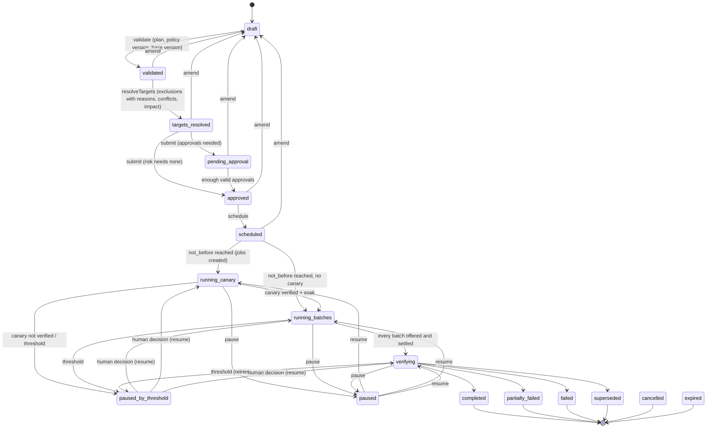
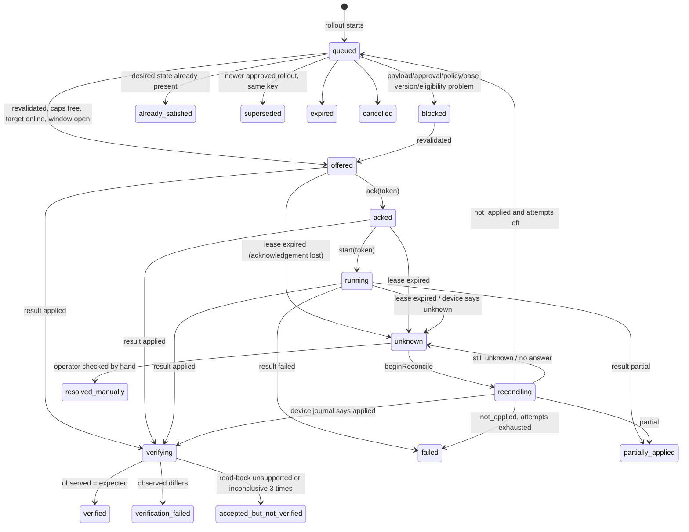
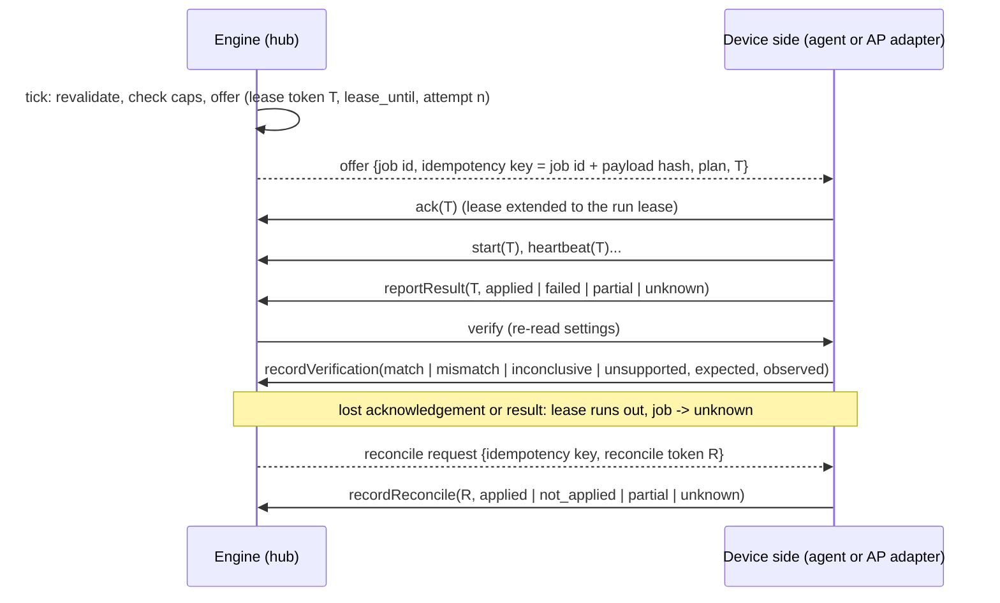

# Rollout and job orchestration engine (P7-0)

Shared core for endpoint fleet changes (software, scripts, configuration, patches) and Wi-Fi configuration rollouts (DECISIONS W-3). It is a deterministic state-machine library in TypeScript with an injected persistence interface, an injected clock and id generator, and an in-memory store for tests. Later packages persist it in PostgreSQL (P7-1/P7-2, Wi-Fi rollout package) and drive it from the worker and the agent API.

**Status: orchestration verified with fakes only.** No database, no agent, no screen, no real adapter exists yet. The fake adapter proves orchestration; it proves nothing about how a NETGEAR AP or a Windows PC behaves. Nothing in this package may be cited as real-device validation.

## Files

| File | What it holds |
|---|---|
| `lib/jobs/canonical.ts` | Canonical JSON (`canonicalize`), strict JSON reader (`parseJsonStrict`, refuses duplicate keys), `sha256Hex` |
| `lib/jobs/plan.ts` | `payloadHash(plan)`, structural `validatePlan` |
| `lib/jobs/approvals.ts` | Approval rules per risk level, `evaluateApprovals`, `checkNewApproval` |
| `lib/jobs/window.ts` | Zone-explicit instants and maintenance windows |
| `lib/jobs/machines.ts` | Rollout and job transition tables and state sets |
| `lib/jobs/planner.ts` | Target order, canary/batch assignment, setting-path overlap, thresholds, summary, final state, recovery actions |
| `lib/jobs/store.ts` | `JobStore` interface (atomic compare-and-set commit + append-only events) and `InMemoryJobStore` |
| `lib/jobs/engine.ts` | `JobEngine`: rollout lifecycle, tick (start, phases, offers, lease expiry), job protocol, revalidation, supersession, conflicts |
| `lib/jobs/adapter.ts` | `JobAdapter` interface (describeCapabilities, preflight, snapshot, apply, reconcile, verify, rollback, stop) |
| `lib/jobs/runner.ts` | `RolloutRunner`: push-style driver of hub-side adapters through the engine protocol |
| `lib/jobs/fake-adapter.ts` | Scriptable `FakeAdapter` (latency, faults per target/step, lost acknowledgements, duplicate delivery, offline/online, partial application, false success, drift, unsupported operations) |
| `lib/jobs/redact.ts` | Redaction of event details and verification diffs; lease-token fingerprints |
| `lib/jobs/testing.ts` | Fake clock, sequential ids, seeded RNG, plan/candidate builders, test environment, world harness, event-log analyser (tests and local simulation only; not for application code) |

## Plan, payload hash and approvals

A **plan** is the immutable execution payload: kind, adapter, artifact (id, immutable version, SHA-256), exact parameters (plain JSON; secrets only as references such as `vault:...`), policy version, target-selector snapshot, base configuration version, supersede key, setting paths, conflict policy, schedule (`not_before`, maintenance window), expiry, canary spec, batch spec, failure thresholds, attempts per target, risk level and requester. Every field influences execution or its approval rule, so the **payload hash** covers the whole plan:

`payload_hash = SHA-256("drishti.plan.v1\n" + canonicalize(plan))`

Canonical JSON rules: keys sorted by UTF-16 code units (RFC 8785 order) after NFC normalisation; strings NFC-normalised, lone surrogates refused; numbers finite, `-0` → `0`, integers at or beyond 2^53 refused (send them as strings), other numbers in shortest round-trip form; an object property whose value is `undefined` is left out; `undefined` elsewhere, bigint, functions, symbols, dates, maps, sets, class instances, sparse arrays, cycles and nesting deeper than 64 are refused. `parseJsonStrict` applies the same rules to JSON text and also refuses duplicate keys (including keys that become equal after escapes or normalisation).

**Approvals** reference the payload hash the approver reviewed. Rules per risk level are configurable (default: low none, medium one, high two). An approval counts only while its hash equals the rollout's current hash, the approver is not the requester and has not already been counted, and (when the impact needs it) the approver acknowledged the impact. A rejection of the current hash cancels the rollout. Any change of the plan before start gives a new hash, returns the rollout to `draft`, clears the targets and leaves the earlier approvals as history that no longer counts. After start the plan cannot change (`immutable_after_start`). Before every offer the engine recomputes the hash from the stored plan and re-evaluates the approvals, so a tampered or changed payload is never offered. The capability check of the approver (`it.*` / `wifi.deploy.approve` with scope) belongs to the calling Server Action.

## Rollout states

Not drawn: every non-terminal state can go to `cancelled` (pending approval: also by rejection); every state from `targets_resolved` on can go to `expired`; the running states can finish directly (`completed`, `partially_failed`, `failed`, `superseded`) when all jobs are terminal. The table in `lib/jobs/machines.ts` is authoritative; every write is checked against it and an invalid transition returns `invalid_transition`.

## Job states (one job per included target)

`unknown` is never re-queued or re-offered directly: the only way back to the queue is `reconciling → queued` after the device answered `not_applied`, and only while attempts remain. Active states (holding the target): `offered`, `acked`, `running`, `verifying`, `unknown`, `reconciling`.

## Protocol between the hub and adapters

The engine never calls a device. A caller reports each protocol message; every message that writes is guarded by the lease token and the record version.

**PowerShell endpoint agent (pull, outbound).** The agent's check-in is the transport. The check-in response carries new offers (signed envelope per D-9 with device id, job id, artifact version and hash, exact parameters, expiry, policy version, approval ids) and open reconcile requests. The agent writes the offer to its persistent local journal before acknowledging (`ack`), runs it, writes the outcome to the journal, and sends `reportResult` on the same or the next check-in. A reconcile request is answered from the journal by idempotency key, so a job that ran while the acknowledgement was lost is reported `applied` and is never run twice; `not_applied` means the journal has no record and the job may be offered again with a new lease token but the same key. Verification for settings (wallpaper, screensaver, installed software version) is the agent's read-back reported with the result, or a later inventory read; an exit code alone is never `verified`.

**Wi-Fi AP adapter (push, hub-side).** `RolloutRunner` is the transport: for each offer it takes a configuration snapshot where supported (`recordSnapshot`), calls `apply(target, plan, idempotencyKey)` over the wired/SD-WAN management path, and reports `ack` + `reportResult`. If no answer arrives (`delivered: false`) it reports nothing and never re-sends: the lease runs out, the job becomes `unknown`, and when the AP is reachable the runner calls `reconcile` (which, for an AP without a journal, means reading the configuration and comparing it with the desired state) and then `verify`. `acknowledged: true` on a lost answer means the AP confirmed receipt before the link dropped; the job is `acked` and becomes `unknown` at the end of its run lease.

## Revalidation (before every offer, and when a target returns)

In this order: rollout cancelled → `cancelled`; expiry passed → `expired`; a newer rollout (higher seq) with the same supersede key in an approved-or-later, non-cancelled state includes the target → `superseded`; stored hash ≠ hash of the stored plan, or job hash ≠ rollout hash → `blocked(payload_changed)`; approvals no longer satisfied → `blocked(approval_missing)`; policy version changed → `blocked(policy_changed)`; a newer base configuration version exists → `blocked(stale_configuration_version)`; target offline, before `not_before`, or window closed → wait (no state change); target no longer eligible → `blocked(ineligible: reasons)`; desired state already present (read-only probe) → `already_satisfied` without executing; otherwise offer. `targetReturned(target)` applies this to the target's waiting jobs and then ticks.

## Supersession and conflicts

- **Supersession.** Jobs carry the plan's `supersedes_key` (e.g. `wifi:profile:<profile_id>:<location>`, `desktop:wallpaper`). When a newer rollout with the same key is approved, queued and blocked jobs of older rollouts on the same targets are superseded at once; the tick and revalidation catch the remaining order (an older rollout starting after a newer one was approved). Jobs in flight are never superseded: they finish, and the newer job waits through per-target exclusivity.
- **Conflicts.** Two rollouts with different (or no) supersede keys conflict on a target when their setting paths overlap (equal, or one contains the other at a dot boundary). With conflict policy `reject` (default) target resolution is refused with `conflicting_rollout` and the list of (target, setting path, other rollout). With `wait` the conflicts are recorded and, on each target, conflicting jobs run strictly in rollout order: a job waits while any earlier conflicting rollout has unfinished work (or has not started) on that target. This ordering applies whatever the policy.
- **Stale base version.** A plan built on configuration version N while N+1 exists is refused at validation ("stale configuration version") and blocked at revalidation if N+1 appears later.

## Canary, batches, thresholds, windows, cancel, expiry

- Targets are ordered deterministically: locations sorted, targets sorted within a location, taken round-robin so batches spread over locations.
- Canary: `explicit` ids, `first_n`, or `per_location` (default rule: the first target of every location), or `none`. Batches follow only when every canary job is `verified` or `already_satisfied` (superseded is neutral) and the soak time has passed; anything else (including `accepted_but_not_verified`) pauses with `paused_by_threshold` until a human resumes.
- Batches: `batch_size`, a per-rollout `global_concurrency` cap and a `per_location_concurrency` cap counted across all rollouts (default 1: one AP at a time per location). A batch is settled when every job is finished, unknown (held visibly), blocked, or waiting for an offline target; offline targets do not stall the rollout and are offered when they return until expiry, while the rollout shows `verifying`. `block_location_on_unknown` stops new offers at a location with an unknown job.
- Thresholds: absolute failures, percentage of finished targets (after `pct_min_finished`), consecutive failures. They count failures since the last human decision; resuming after `paused_by_threshold` acknowledges the failures so far and resets the consecutive count. Failures are `failed`, `verification_failed`, `partially_applied`.
- Maintenance windows gate new offers only (absolute instants with an explicit offset, or daily windows in a named IANA zone, crossing midnight allowed, days counted by the day the window opens). Jobs in flight continue.
- Cancel: the rollout becomes `cancelled` at once; queued and blocked jobs are cancelled; jobs in flight are asked to stop when the adapter supports it (`stop: requested`), otherwise left to complete (`stop: unsupported_left_to_complete`), and both are recorded. Their results are still accepted; an unknown job can still be reconciled.
- Expiry: at `expires_at` nothing new is offered, queued jobs expire, the rollout becomes `expired`; jobs in flight finish as above.

## Results taxonomy

Per target the job keeps separate facts: requested (the job exists), `applied` flag (a result or reconciliation said applied), `partial` flag, the verification record (outcome, redacted expected and observed maps), the snapshot reference and rollback outcome, the stop record, and a terminal reason. `accepted_but_not_verified` is never counted as verified. The rollout summary (`summarize`) reports requested, applied, partial, verified, already satisfied, accepted but not verified, failed (= apply failed + verification failed + partial), unknown (unknown + reconciling), in progress, waiting, blocked, cancelled, expired, superseded, resolved manually, finished and `is_partial` (some succeeded and some failed, or a partial application: there is no atomic transaction across targets). Recovery actions per job: `reconcile` and `retry_after_reconcile` for unknown; `restore_snapshot` (only when a snapshot was taken and the adapter can roll back, and not yet restored) and `manual` for failures.

## Invariants (checked by the property test after every random action)

1. Never two active jobs for one target, across rollouts.
2. Never executes an unapproved or changed payload: every execution in the fake's log carries the hash of its job and rollout, and that rollout's approvals are valid for it; no idempotency key executes twice.
3. Never retries an `unknown` job without reconciliation: every re-offer is preceded by `reconciling → queued (reconciled_not_applied)`; offers never exceed `max_attempts`.
4. Never exceeds the per-rollout global cap or the per-location cap.
5. The event log is monotonic (consecutive sequence numbers, time never goes back) and complete (replaying the transitions gives exactly the stored state of every job and rollout; every transition's `from` is the previous `to`).
6. Counters are consistent (states sum to jobs; verified ≤ applied ≤ requested; failed = apply failed + verification failed + partial; finished + waiting + in progress + unknown = requested); terminal rollouts stay terminal; record versions only grow; lease tokens never appear in events.
7. Liveness: once faults are cleared and targets are online, every started rollout and every job reaches a terminal state.

Three deliberate mutations were each caught by the property test during development: removing the per-target exclusivity check, re-queueing a job whose reconciliation answered `unknown`, and letting an amendment change a running plan.

## Failure modes

| Failure | What the engine does |
|---|---|
| Acknowledgement lost (offer delivered, no ack) | Lease expires → `unknown`; reconcile; never re-sent blindly |
| Result lost after ack | Run lease expires → `unknown`; reconcile |
| Device reports `unknown` (rebooted mid-change) | `unknown`; reconcile |
| Device answers reconcile `unknown` / unreachable | Stays `unknown`, visible, holds the target (and the location if configured); operator may resolve by hand |
| Duplicate ack / result / reconcile answer | Same token and same content → same outcome, no new event |
| Different second result for one lease | Refused (`conflicting_duplicate`), logged, first stands |
| Message with a stale or forged token | Refused (`stale_lease`), logged with a token fingerprint, no state change |
| Two writers on one record | Compare-and-set on `version` refuses the stale write (`version_conflict`); the next tick retries |
| Target offline when queued | Waits; on return revalidated (expiry, supersession, payload, approvals, policy, base version, eligibility, already satisfied) |
| Plan changed after approval | Back to draft; approvals no longer count; nothing executes |
| Device claims success but did not change | Verification `mismatch` → `verification_failed` (distinct from `failed`) |
| Read-back unsupported | `accepted_but_not_verified`; a canary in this state pauses for a human |
| Partial application | `partially_applied`, `partial` flag; restore snapshot if supported, else manual |
| Failures above threshold | `paused_by_threshold`; only a human resumes or cancels |

## Rulings made where the brief was open

1. An object property whose value is `undefined` is left out of the canonical form; integers at or beyond 2^53 (including `1e21`) are refused; keys equal after NFC are refused; the hash is domain-tagged.
2. The whole plan is hashed, including risk and requester (they decide the approval rule); the rollout title is not part of the plan.
3. A rejection cancels the rollout (the brief's state list has no `rejected`).
4. An offer whose acknowledgement never arrives becomes `unknown` (the device may have received it). A result with the valid token is accepted even after `lease_until` as long as the engine has not yet moved the job; afterwards the token is stale. A result with the valid token is accepted without a prior ack (it proves receipt).
5. `unknown` and `reconciling` count as active: they hold the target and count toward the per-location cap; `block_location_on_unknown` additionally stops the location regardless of the cap.
6. Per-location concurrency is counted across all rollouts (coverage is per location); the global cap is per rollout.
7. Offline targets do not stall batches (see "Batches"); an offline canary does stall the canary phase, because the canary is the evidence for the rest.
8. Thresholds count failures since the last human decision; resuming acknowledges them; a canary failure is overridden by an explicit resume.
9. Conflicting jobs on one target run in rollout order whatever the policy; `reject` refuses at target resolution against any conflicting rollout (older or newer) that holds the target; the same supersede key is supersession, not conflict.
10. Only queued/blocked jobs are superseded; "newer" means a higher rollout sequence number; a cancelled, expired or draft rollout supersedes nothing.
11. Policy-version change and a newer base version block (not cancel) waiting jobs; a human cancels or a newer rollout supersedes them.
12. `cancelled` and `expired` rollouts are terminal at once; jobs in flight still report and are recorded; a reconcile `not_applied` in a cancelled rollout cancels the job instead of retrying.
13. Final state: all superseded → `superseded`; no failure → `completed`; failures and successes → `partially_failed`; only failures → `failed` (`resolved_manually` is neutral; `accepted_but_not_verified` is a success for the final state but never "verified").
14. The impact needs acknowledgement when any target disrupts service, needs a reboot or a reconnect, or has no estimate.
15. Inconclusive verification is retried up to three times, then `accepted_but_not_verified`.
16. The "already satisfied" read-only probe runs before every offer, not only on return.
17. The old Plan 6 queue design (`sent` returns to `queued` after 15 minutes, three attempts) is superseded by the directive: no automatic re-queue without reconciliation.

## What remains for the database-backed implementation (P7-1/P7-2, Wi-Fi rollout package)

- **Tables** (forward migration, explicit REVOKE/GRANT, RLS, `SET search_path = ''` on SECURITY DEFINER functions): `fleet_rollouts` (plan jsonb, payload_hash, state, seq, counters, version), `fleet_rollout_approvals` (append-only, hash-bound), `fleet_rollout_targets` / `fleet_rollout_exclusions`, `fleet_jobs` (one row per target, state, lease token hash, lease_until, attempt, reconcile lease, flags, verification jsonb redacted, snapshot ref, version), `fleet_job_events` (append-only, sequence, no UPDATE/DELETE grants; later hash-chained per D-15).
- **Store**: `commit` as one transaction: `UPDATE ... SET ..., version = version + 1 WHERE id = $1 AND version = $2` for every record (zero rows → `version_conflict`, roll back), then insert the events. Lease tokens stored as hashes; the token goes only to the device.
- **Leases in PostgreSQL**: lease expiry by `lease_until < now()` in the tick (worker under the D-8 lease and fencing token), offers selected `FOR UPDATE SKIP LOCKED`; per-target exclusivity also as a partial unique index on `fleet_jobs (target_id) WHERE state IN (active states)` so the database enforces invariant 1 even against a buggy writer; per-location caps checked in the same transaction.
- **Environment**: policy versions, base configuration versions (Wi-Fi profiles), presence (agent check-ins, AP reachability from monitoring), eligibility (enrolment, revocation, capability matrix W-2 with `lab_validated` gating) read from the database.
- **Signing (D-9)**: the offer becomes a signed envelope from the separate signer, which checks requester capability and fresh MFA, approvals by distinct approvers referencing the payload hash, current policy version and device enrolment before signing.
- **Agent side**: persistent local execution journal keyed by idempotency key (RM-2), reconcile answers from it, per-user handling when running as SYSTEM.
- **Server Actions**: capability × scope checks (`it.*`, `wifi.deploy.approve`, `wifi.deploy.execute`, location scope) before calling the engine; `Result` to the client.
- **Real adapters**: Windows agent kinds (WP-7.3) and Wi-Fi vendor adapters only where official documentation supports them, `experimental` until lab-validated (W-3); first-hardware-pilot checklist.
- **Not covered here**: profiles and effective-configuration preview (WF-6/WF-7), drift detection (WF-12), UI (WF-15), audit integration with D-15 checkpoints.

## Tests

`npx vitest run tests/unit/jobs-*.test.ts` — canonical JSON, plan hash and validation, windows, approvals, transition tables, store, redaction, planner, engine lifecycle, engine protocol, fake adapter, scenarios (staff SSID on five APs, selected stores with local settings kept, incompatible exclusion, offline AP returning after a newer profile, payload changed after approval, stale base version, policy change while offline, already satisfied, concurrent rollouts rejected or ordered, threshold pause then resume/abort/recovery, lost acknowledgement and lost request reconciled, lost result after ack, unknown blocking one location, duplicate result, maintenance window gating, cancel with and without stop support, expiry, verification failure versus apply failure with snapshot restore, read-back unsupported, unverifiable canary, MAC rule on compatible APs, event-log completeness) and the seeded property test (`JOBS_PROPERTY_RUNS`, default 2000 runs, about 30 s).
